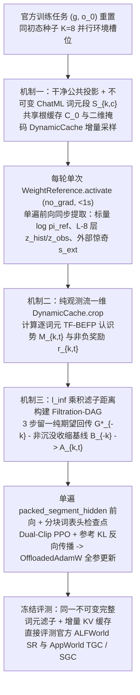

# F-GPO：基于因果滤子有向无环图与逐词元贝叶斯认识前沿的长时程智能体强化学习方案

> [!IMPORTANT]
> **核心主旨**：F-GPO（Filtration-DAG Group Policy Optimization）直接建立在仓库现有 `GiGPO` / `BiPACE_Q` 的全参数原生强化学习底座之上，移除死板的墙钟时间效用 $U_B$、资源状态向量 $\beta_t$ 与低配额训练熔断，直接最大化官方基准终局成功率 $\max_\theta \mathbb{E}_{\pi_\theta}[Y]$。方案仅凭标准公开交互历史滤子，从第一性原理闭环解决现有基线在部分可观测长时程环境中的三项结构难题：**跨百步记忆丢失与局部观测马尔可夫混叠、全零失败采样组的冷启动零梯度死锁、以及失败轨迹中优质信息收集前缀的跨轨迹正向信用回传**，全程零门控、零规则补丁、零校准、零环境特权钩子。

---

## 一、问题重构与现有基线的源码级第一性原理诊断

家庭具身交互（**ALFWorld**，时域上限 $H=50$）与多应用数据库协同编程（**AppWorld**，时域上限 $H=100$）本质上是**终局二元奖励极度稀疏的部分可观测马尔可夫决策过程（POMDP）**。在每个任务实例中，智能体初始仅获知公开任务指令 $g$ 与初始环境观测 $o_0$，目标物体所在容器、业务数据库真实记录及接口隐式前置条件均隐藏在环境潜态 $s_0$ 中。步骤 $t$ 的真实信息状态由完整公开因果交互滤子（Filtration）唯一刻画：

$$\mathcal{F}_t = \sigma(g, o_0, y_0, o_1, \dots, y_{t-1}, o_t).$$

前中期的打开容器、检索接口文档、遍历分页记录与提取凭证均无即时环境奖励，唯有闭合整条信息获取与状态修改因果链并正确提交，官方评测器才在终局给出 $Y \in \{0, 1\}$。将优化目标纯粹回归官方成功率 $\max_\theta \mathbb{E}_{\pi_\theta}[Y]$ 并解除微预算饥饿截断，具有直接的仓库实证支撑：在历史实测记录 [host_b_qwen7b_baseline_reference.json](file:///Users/cxw/Documents/科研方案实现/long-horizon-decision/results/dcc-v2-r5-pilot-diagnostics-20261111/host_b_qwen7b_baseline_reference.json#L20-L32) 中，`8M` 前向计算词元上限使 `GiGPO` 在首轮 128 条轨迹中仅采完 16 条（消耗 `8,000,590` 词元）即被强行终止，实际完成梯度更新 `gradient_steps = 0`；早期路线（见 [README.md](file:///Users/cxw/Documents/科研方案实现/long-horizon-decision/results/dcc-v2-r5-pilot-diagnostics-20261111/README.md#L35-L45) 与 [native_policy.py](file:///Users/cxw/Documents/科研方案实现/long-horizon-decision/src/prism_evolve/native_policy.py#L2965-L2996)）外挂脱离预训练分布的双模态门控与墙钟衰减目标 $U_B = Y(1-\tau/B)_+$，诱发短命令覆盖与重复动作死循环，致使表现低于冻结基座。

直接在 [native_real_baselines.py](file:///Users/cxw/Documents/科研方案实现/long-horizon-decision/src/prism_evolve/native_real_baselines.py) 与 [native_real_baseline_training.py](file:///Users/cxw/Documents/科研方案实现/long-horizon-decision/src/prism_evolve/native_real_baseline_training.py) 的全参数原生策略主干上实施内生重构，能够完整继承预训练模型的 `<think>` 推理与自由 Python 代码生成能力，精准定位并攻克现有四类基线尚未解决的三重断层：

### 1.1 短视窗口截断、契约错位与局部观测混叠偏置

在现有基线实现中，`_method_messages`（[native_real_baselines.py](file:///Users/cxw/Documents/科研方案实现/long-horizon-decision/src/prism_evolve/native_real_baselines.py#L287-L305)）将 `GiGPO` 与 `BiPACE_Q` 的上下文硬截断为最近两步 `history_length = 2`，两步前查明的 API 参数签名、登录令牌与已排查容器在 $t \ge 3$ 时彻底蒸发；同时首轮消息仅提取 `"instruction"` 而丢弃 [native_envs.py](file:///Users/cxw/Documents/科研方案实现/long-horizon-decision/src/prism_evolve/native_envs.py#L580-L589) 构造的 AppWorld 初始引导观测 $o_0$（含 `supervisor` 档案、系统时间与引导 API 文档），并在 `train()`（[native_real_baselines.py](file:///Users/cxw/Documents/科研方案实现/long-horizon-decision/src/prism_evolve/native_real_baselines.py#L534)）中将 AppWorld 步限锁死为 `50`（官方时域为 `100`），且在 `run_episode`（[native_real_baselines.py](file:///Users/cxw/Documents/科研方案实现/long-horizon-decision/src/prism_evolve/native_real_baselines.py#L437)）中直接调用 `env.step(action)` 而未走原生执行入口 `step_native`（[native_envs.py](file:///Users/cxw/Documents/科研方案实现/long-horizon-decision/src/prism_evolve/native_envs.py#L967-L971)）。

在信用分配层面，`group_advantages` 与 `anchor_embeddings`（[native_real_baseline_training.py](file:///Users/cxw/Documents/科研方案实现/long-horizon-decision/src/prism_evolve/native_real_baseline_training.py#L114-L138)、[native_real_baseline_training.py](file:///Users/cxw/Documents/科研方案实现/long-horizon-decision/src/prism_evolve/native_real_baseline_training.py#L267-L302)）仅依据瞬时观测 `row.anchor_obs` 聚类跨轨迹状态：子目标完成前后的相同房间文本、`stdout` 空字符串 `""` 或 `"Nothing happens."` 被强行归入同一状态簇。设初态隐藏潜变量 $Z \sim \mathrm{Uniform}(\{1,\dots,M\})$（$M \ge 2$），必要探索动作 $a_{\text{read}}$ 读取 $Z$ 后回到同构局部观测 $o_{\text{post}} = o_0$ 并确定性完成任务（读前步折扣回报 $10\gamma$，读后步 $10$）。按瞬时观测 $o_t$ 聚类会将读前步与读后步并入同一簇 $C(o_0)$，拉高簇均值至 $\widehat{V}_{\text{obs}}(C(o_0)) = 5(1+\gamma)$，导致促成成功的必要读取动作反而承受严格负优势：

$$\widehat{Q}_{\text{obs}}(C(o_0), a_{\text{read}}) - \widehat{V}_{\text{obs}}(C(o_0)) = 10\gamma - 5(1+\gamma) = -5(1-\gamma) < 0, \qquad \forall \gamma \in (0, 1).$$

与此同时，单条失败轨迹若在前中期完成了正确的信息查询，随后在下游步骤失误导致 $Y_k=0$，`GiGPO` 与 `BiPACE_Q` 依赖单条轨迹自身的蒙特卡洛回报 `discounted_score`，无法将同伴轨迹在相同信息状态下取得的下游成功价值回传给该优质探索前缀。

### 1.2 全零采样组梯度坍缩、惩罚反相与事后蒸馏因果倒置

在复杂任务早期，同初态采样的 $K=8$ 条轨迹常出现全败（$Y_1 = \dots = Y_K = 0$）。此时 `Skill-DisCo`（[native_real_baselines.py](file:///Users/cxw/Documents/科研方案实现/long-horizon-decision/src/prism_evolve/native_real_baselines.py#L634-L639)）因成功轨迹集为空无法归纳任何技能且基座权重冻结；`GiGPO` 与 `BiPACE_Q` 在全合法动作下组内回报方差为零，整批百步交互产生零梯度；而一旦组内出现 1 个语法解析违规步（`assign_returns` 扣罚 `-0.1`，见 [native_real_baseline_training.py](file:///Users/cxw/Documents/科研方案实现/long-horizon-decision/src/prism_evolve/native_real_baseline_training.py#L70-L71)）与若干合法原地空转步（得分 `0.0`），`_sample_normalize` 会将全部合法空转步翻转为**正优势**，直接强化死循环。`SELF`（[native_real_baseline_training.py](file:///Users/cxw/Documents/科研方案实现/long-horizon-decision/src/prism_evolve/native_real_baseline_training.py#L448-L495)）虽利用环境反馈文本，但无差别最小化 $D_{\mathrm{KL}}(\pi_\theta(\cdot\mid h_t) \,\|\, \pi_{\text{EMA}}(\cdot\mid h_t, o_{t+1}))$：当 $o_{t+1}$ 含有隐藏潜态信息时迫使学生在读取前盲猜未来值，而当错误动作触发确定性异常堆栈 $o_{t+1}$ 时，教师由报错反推出该错误动作，反而驱动学生强化报错行为（且在 AppWorld 空 `stdout` 回合直接触发空目标异常）。

### 1.3 二次方前缀重算、锁页内存耗尽与参考权重重复搬运

现有采样与 `response_hidden`（[native_real_baseline_training.py](file:///Users/cxw/Documents/科研方案实现/long-horizon-decision/src/prism_evolve/native_real_baseline_training.py#L305-L332)）对轨迹每一步 $t$ 从头重跑完整前缀 Transformer，单条长轨迹产生 $2T_k$ 次完整前向，计算量膨胀至 $\Theta(T_k^2 \bar{L})$；`_activation_saving`（[native_real_baselines.py](file:///Users/cxw/Documents/科研方案实现/long-horizon-decision/src/prism_evolve/native_real_baselines.py#L190)）开启 `save_on_cpu(pin_memory=True)`，在变长长序列反向传播时耗尽 CUDA 锁页主机内存池；`WeightReference.activate`（[native_real_baseline_training.py](file:///Users/cxw/Documents/科研方案实现/long-horizon-decision/src/prism_evolve/native_real_baseline_training.py#L241-L258)、[L375](file:///Users/cxw/Documents/科研方案实现/long-horizon-decision/src/prism_evolve/native_real_baseline_training.py#L375)）在每个 minibatch 内往返搬运全模型权重，单轮 16 个 minibatch 累计产生逾 `700 GB` PCIe 拷贝。

---

## 二、机制一：干净公共投影、不可变词元滤子代数与线性计算等价性

为彻底消除历史遗忘、边界重分词漂移与 $\Theta(T^2 \bar{L})$ 重复计算，F-GPO 在不改动环境模拟器源码的前提下，于智能体入口建立干净公共观测投影与严格整数词元追加律。

### 2.1 干净公共观测投影 $\Pi_{\text{pub}}$

定义防特殊符注入分词算子 $\operatorname{enc}(s) \triangleq \mathrm{tokenizer.encode}(s,\; \texttt{add\_special\_tokens=False},\; \texttt{split\_special\_tokens=True})$，阻断环境返回文本伪造 ChatML 角色边界：

- **AppWorld（$H=100,\; M_{\text{gen}}=1024$）**：系统提示取 `m_sys = action_schema["native_system_prompt"]`（[native_policy.py](file:///Users/cxw/Documents/科研方案实现/long-horizon-decision/src/prism_evolve/native_policy.py#L1254-L1258)，声明预置 `apis`、持久变量、`api_docs` 查询与 `supervisor.complete_task` 协议）；初始纯净观测 $\widetilde{o}_{k,0}$ 取 `context["observation"]`（完整保留 `supervisor`、系统时间与 4 份引导文档，且与任务指令 $g$ 分离）；$t \ge 1$ 时对超长 `stdout` 在入史时刻做一次性不可变首尾截断（超 1,024 词元时保留前 512 + `"\n...[truncated]...\n"` + 后 512 词元，空输出保留为空观测流且消息体记 `"[Empty stdout]"`）。首轮用户帧为 $\widetilde{u}_{k,0} = \mathrm{json}(\{\text{"task"}: g, \text{"observation"}: \widetilde{o}_{k,0}\})$，后续用户帧为 $\widetilde{u}_{k,t} = \widetilde{o}_{k,t}$。
- **ALFWorld（$H=50,\; M_{\text{gen}}=256$）**：从 [native_text_envs.py](file:///Users/cxw/Documents/科研方案实现/long-horizon-decision/src/prism_evolve/native_text_envs.py#L204-L218) 的 `_publish` JSON 信封中仅提取 `native_observation` 与公开 `available_actions`（剥离 64 位 SHA-256 `public_state_id`、`mode_actions` 与 `probe_actions`，消除哈希伪惊奇噪声与内部模式字段）；剥离首轮反馈中重复的 `"Your task is to: ..."` 行得到纯场景观测 $\widetilde{o}_{k,t}$；系统提示明确要求 `<think>...</think>\n<action>...</action>` 格式，与 `extract_native_text`（[native_text_actions.py](file:///Users/cxw/Documents/科研方案实现/long-horizon-decision/src/prism_evolve/native_text_actions.py#L82-L86)）严密对齐。用户帧将静态可用命令置于前部、动态当前观测置于末尾：首轮 $\widetilde{u}_{k,0}$ 为 `"Task: {g}\nAdmissible commands: {cmds_0}\nCurrent observation:\n{obs_0}"`，后续 $\widetilde{u}_{k,t}$ 为 `"Admissible commands: {cmds_t}\nCurrent observation:\n{obs_t}"`，50 步总长约 $1.1 \times 10^4 < 32,768$ 词元，单段即可无损容纳全时程交互记忆。

### 2.2 双终止符闭合词元滤子与整轮原子分段律

记 `Qwen/Qwen2.5-7B-Instruct` 词表为 $\Sigma$，`<|im_start|>` 为 $s_{\text{bos}}=151644$，`<|im_end|>` 为 $s_{\text{im\_end}}=151645$，`<|endoftext|>` 为 $s_{\text{eot}}=151643$，`\n` 为 $s_{\text{nl}}=198$，上下文容量 $C_{\max}=32768$，提示安全上限 $C_{\text{prompt}} = C_{\max} - M_{\text{gen}}$。

**定义 1（不可变词元滤子与原子分段律）**  
首轮锚定词元块定义为 $\mathbf{B}_{\text{pin},k} \triangleq \operatorname{apply\_chat\_template}([m_{\text{sys}}, m_{\text{user}}(\widetilde{u}_{k,0})],\; \texttt{add\_generation\_prompt=True})$，初始提示 $\mathbf{p}_{k,0} \triangleq \mathbf{B}_{\text{pin},k}$。第 $t$ 步自回归采样响应词元序列 $\mathbf{y}_{k,t} = (z_{k,t,1}, \dots, z_{k,t,m_{k,t}}) \sim \pi_{\theta_{\text{old}}}(\cdot \mid \mathbf{p}_{k,t})$（同步记录采样对数概率 $\ell^{\text{old}}_{k,t,i}$）并执行动作获得 $\widetilde{u}_{k,t+1}$ 后，直接在整数词元空间构造闭合分隔符与原子轮次块：

$$\mathbf{d}_{k,t} \triangleq \begin{cases} (s_{\text{nl}}), & z_{k,t,m_{k,t}} = s_{\text{im\_end}}, \\ (s_{\text{im\_end}}, s_{\text{nl}}), & z_{k,t,m_{k,t}} \neq s_{\text{im\_end}}, \end{cases}$$

$$\mathbf{u}_{k,t+1} \triangleq (s_{\text{bos}}) \oplus \operatorname{enc}(\texttt{"user\n"}) \oplus \operatorname{enc}(\widetilde{u}_{k,t+1}) \oplus (s_{\text{im\_end}}, s_{\text{nl}}, s_{\text{bos}}) \oplus \operatorname{enc}(\texttt{"assistant\n"}),$$

$$\mathbf{B}_{k,t} \triangleq \mathbf{y}_{k,t} \oplus \mathbf{d}_{k,t} \oplus \mathbf{u}_{k,t+1}, \qquad \widetilde{\mathbf{o}}_{k,t+1} \triangleq \operatorname{enc}(\widetilde{o}_{k,t+1}) \in \Sigma^{L_{k,t+1}}.$$

当 $|\mathbf{p}_{k,t}| + |\mathbf{B}_{k,t}| \le C_{\text{prompt}}$ 时，单调追加 $\mathbf{p}_{k,t+1} \triangleq \mathbf{p}_{k,t} \oplus \mathbf{B}_{k,t}$ 并延伸当前连续段 $\mathbf{S}_{k,c}$（段闭合终态序列为 $\mathbf{S}_{k,c} = \mathbf{p}_{k,t_{\text{end}}} \oplus \mathbf{y}_{k,t_{\text{end}}}$）；若极长百步轨迹在某轮突破 $C_{\text{prompt}}$，则闭合 $\mathbf{S}_{k,c}$，直接在词元块空间拼接 $\mathbf{B}_{\text{pin},k} \oplus \bigoplus_{u=r(t)}^t \mathbf{B}_{k,u}$（取总长 $\le 0.75\, C_{\text{prompt}}$ 的最小轮次 $r(t)$）开启新段 $\mathbf{S}_{k,c+1}$，每步唯一归属单一段。

**定理 1（段内严格整数前缀律与并行 `DynamicCache` 采样等价性）**  
*在任意连续段 $\mathbf{S}_{k,c}$ 内，对一切段内步骤 $t < t'$ 恒有严格整数前缀包含关系 $\mathbf{p}_{k,t} \oplus \mathbf{y}_{k,t} \prec \mathbf{p}_{k,t'} \preceq \mathbf{S}_{k,c}$。在关闭 Dropout（`p = 0`）下：（i）同组 $K=8$ 条同初态轨迹单次预填充 $\mathbf{B}_{\text{pin},k}$ 产出根缓存 $\mathcal{C}_0$ 并克隆广播，结合独立槽位目录与二维有效掩码 `cache_valid_mask`、显式二维 RoPE 位置 `position_ids = (cache_valid_mask.long().cumsum(-1) - 1)` 批量增量推进 $\Delta^{\text{kv}}_{k,t+1} = (z_{k,t,m_{k,t}},) \oplus \mathbf{d}_{k,t} \oplus \mathbf{u}_{k,t+1}$，所得采样分布与逐轮独立全序列预填充逐位恒等；（ii）单轨迹采样预填充总词元数由 $\Theta(T_k^2 \bar{L})$ 降至 $\sum_{c=1}^{C_k} |\mathbf{S}_{k,c}| = \Theta(T_k \bar{L})$。*

*证明*：定义 1 全程以整数词元块拼接，彻底杜绝文本重拼时 `<|im_start|>assistant\n` 末尾换行符（`198`）与响应首换行符（`198`）合并为双换行词元（`271`）的 BPE 边界漂移；无 Dropout 因果注意力在显式 `cache_valid_mask` 与连续非填充计数 `position_ids` 下，每个有效词元的 $(K, V)$ 投影及注意力权重仅依赖段内前序有效词元序列，故增量缓存解码与全序列重算严格同分布。$\blacksquare$

**定理 2（`packed_segment_hidden` 与逐轮 `response_hidden` 前反向精确等价性）**  
*记段 $\mathbf{S}_{k,c}$ 内步骤 $t$ 的响应起始偏移为 $a_{k,t} = |\mathbf{p}_{k,t}|$，响应长度为 $m_{k,t} = |\mathbf{y}_{k,t}|$。对无 Dropout 主干 $f_\theta$ 执行单次无缓存因果前向 $\mathbf{H}_{k,c} = f_\theta(\mathbf{S}_{k,c}[:-1])$，切片 $\mathbf{H}_{k,c}[a_{k,t}-1 : a_{k,t}-1+m_{k,t}, :]$ 与逐轮独立调用 `response_hidden(policy, p_{k,t}, y_{k,t})` 的前向隐状态及关于全模型参数 $\theta$ 的反向梯度逐位置精确等价；同时段内纯净观测词元 $\widetilde{\mathbf{o}}_{k,t+1}$ 起始偏移 $b_{k,t+1}$ 处的切片 $\mathbf{H}_{k,c}[b_{k,t+1}-1 : b_{k,t+1}-1+L_{k,t+1}, :]$ 同步给出动作条件外部观测预测分布 $p_\theta(\widetilde{\mathbf{o}}_{k,t+1} \mid \mathcal{F}_{k,t}, \mathbf{y}_{k,t})$。*

*证明*：`response_hidden` 输入序列 $\mathbf{p}_{k,t} \oplus \mathbf{y}_{k,t}[:-1]$ 恰为 $\mathbf{S}_{k,c}[:-1]$ 长度为 $a_{k,t}+m_{k,t}-1$ 的严格前缀；严格下三角因果注意力掩码保证位置 $< a_{k,t}+m_{k,t}-1$ 的全部层激活不依赖任何后缀词元，而闭合结构符 $\mathbf{d}_{k,t} \oplus \mathbf{u}_{k,t+1}$ 不进入策略损失 `lm_head` 投影，由链式法则知全段单次反向传播与 $T_k$ 次独立前反向梯度之和恒等，将每条单段轨迹的 $2T_k$ 次主干前向压缩为 **1 次参考前向 + 1 次策略前向**。$\blacksquare$

---

## 三、机制二：逐词元分解贝叶斯认识前沿势函数（TF-BEFP）

为在全零失败组（$Y_1 = \dots = Y_K = 0$）内提取真正推进任务信息获取的步级信号，同时在不借助任何环境内部钩子、AST 字面量过滤或污点掩码补丁的前提下从数学构造上彻底免疫 `stdout` 回显刷分，F-GPO 仅利用已常驻内存的固定参考模型 $p_{\text{ref}}$（`WeightReference`）构建逐词元分解的贝叶斯认识前沿势函数。

记轨迹 $k$ 截至步骤 $s$ 的纯净观测词元拼接流为 $\widetilde{\mathbf{O}}_{k,s} \triangleq \widetilde{\mathbf{o}}_{k,0} \oplus \dots \oplus \widetilde{\mathbf{o}}_{k,s}$（长 $L^{\text{obs}}_{k,s}$），公开目标词元序列为 $\mathbf{g} \triangleq \operatorname{enc}(g)$。对步骤 $t$ 返回观测 $\widetilde{\mathbf{o}}_{k,t+1}$ 中的第 $j$ 个词元 $w_{k,t+1,j}$（$1 \le j \le L_{k,t+1}$），定义两项基础信息量：

1. **逐词元目标预测对数似然比增益**（衡量目标 $g$ 对纯观测流中该词元的解释力提升）：
   $$\delta^{\text{goal}}_{k,t,j} \triangleq \log p_{\text{ref}}\!\left(w_{k,t+1,j} \,\middle|\, \mathbf{g}, \widetilde{\mathbf{O}}_{k,t}, w_{k,t+1,<j}\right) - \log p_{\text{ref}}\!\left(w_{k,t+1,j} \,\middle|\, \widetilde{\mathbf{O}}_{k,t}, w_{k,t+1,<j}\right).$$
2. **全滤子动作条件外部惊奇度**（衡量该词元超出智能体自身历史代码与当前动作 $\mathbf{y}_{k,t}$ 可预测范围的真实环境新信息量）：
   $$s^{\text{ext}}_{k,t,j} \triangleq -\log p_{\text{ref}}\!\left(w_{k,t+1,j} \,\middle|\, \mathcal{F}_{k,t}, \mathbf{y}_{k,t}, w_{k,t+1,<j}\right) \ge 0.$$

**定义 2（逐词元分解贝叶斯认识前沿势函数 TF-BEFP）**  
记初始目标条件交叉熵 $H^{\text{goal}}_{k,0} \triangleq -\log p_{\text{ref}}(\mathbf{g} \mid \widetilde{\mathbf{O}}_{k,0}) > 0$，定义纯观测流上的目标对数后验单调前沿及其步增量：

$$F_{k,t} \triangleq \max_{0 \le s \le t} \log p_{\text{ref}}\!\left(\mathbf{g} \,\middle|\, \widetilde{\mathbf{O}}_{k,s}\right) \le 0, \qquad \Delta F_{k,t} \triangleq F_{k,t+1} - F_{k,t} = \Big[\log p_{\text{ref}}\!\left(\mathbf{g} \,\middle|\, \widetilde{\mathbf{O}}_{k,t+1}\right) - F_{k,t}\Big]_+ \ge 0.$$

定义步骤 $t$ 的双侧瓶颈认识增量 $\eta_{k,t}$（当 $L_{k,t+1}=0$ 时置 $\eta_{k,t}=0$）与归一化认识势序列 $M_{k,t}$：

$$\eta_{k,t} \triangleq \min\!\left(\Delta F_{k,t},\; \sum_{j=1}^{L_{k,t+1}} \min\!\Big(\big[\delta^{\text{goal}}_{k,t,j}\big]_+,\; s^{\text{ext}}_{k,t,j}\Big)\right) \ge 0, \qquad M_{k,0} \triangleq 0, \qquad M_{k,t+1} \triangleq M_{k,t} + \frac{\eta_{k,t}}{H^{\text{goal}}_{k,0} + 1}.$$

**一维因果 `DynamicCache.crop` 精确无泄漏求值**：在每轮单次 `with torch.no_grad(), reference.activate(policy.model):` 窗口内：（1）对打包段 $\mathbf{S}_{k,c}$ 的单次因果前向同时读出策略参考对数概率与全部 $s^{\text{ext}}_{k,t,j}$（定理 2）；（2）对纯观测流 $\widetilde{\mathbf{O}}_{k,T_k}$（开启 `use_cache=True` 产出键值缓存 $\mathcal{C}^{\text{obs}}$）与前缀拼接流 $\mathbf{g} \oplus \widetilde{\mathbf{O}}_{k,T_k}$ 各执行 1 次标准一维下三角前向即可读出全部 $\delta^{\text{goal}}_{k,t,j}$；（3）沿非空观测步逆序 $s = s_m, \dots, 0$ 对 $\mathcal{C}^{\text{obs}}$ 执行原地裁剪 `kv.crop(L_obs[k, s] - 1)`（对齐 [native_policy.py](file:///Users/cxw/Documents/科研方案实现/long-horizon-decision/src/prism_evolve/native_policy.py#L2053-L2069)），送入尾词元加目标序列 `[\widetilde{O}[L_obs[k,s]-1]] + g[:-1]` 计算精确条件对数似然 $\log p_{\text{ref}}(\mathbf{g} \mid \widetilde{\mathbf{O}}_{k,s})$，全程仅使用标准一维因果注意力与精确连续 RoPE 位置，零未来观测泄漏、零 4D 掩码显存膨胀，单条轨迹求值耗时 `< 15 ms`。

**定理 3（TF-BEFP 严格亚单位上界与逐词元内生防刷定理）**  
*在零模拟器特权钩子、零语法/污点规则补丁下，任意轨迹的认识势序列 $\{M_{k,t}\}_{t=0}^{T_k}$ 满足以下四条严格性质：*
1. **单调非负与严格亚单位上界**：对任意轨迹长度 $T_k$ 恒有 $0 = M_{k,0} \le M_{k,1} \le \dots \le M_{k,T_k} \le \frac{H^{\text{goal}}_{k,0}}{H^{\text{goal}}_{k,0} + 1} < 1$。
2. **数学免疫直接回显（`print(g)`）、单步噪声捆绑（`print(7**777, g)`）与跨步变量中转（`x = ...; print(x)`）**：在任意自造或捆绑打印输出中，算术/随机噪声词元满足 $\delta^{\text{goal}}_{k,t,j} \approx 0$，而源自历史代码或当前代码的回显词元因 $(\mathcal{F}_{k,t}, \mathbf{y}_{k,t})$ 已完整包含赋值与打印语句而满足 $p_{\text{ref}}(w_{k,t+1,j} \mid \mathcal{F}_{k,t}, \mathbf{y}_{k,t}, w_{<j}) \approx 1 \implies s^{\text{ext}}_{k,t,j} \approx 0$；**逐词元取最小** $\min([\delta^{\text{goal}}_{k,t,j}]_+, s^{\text{ext}}_{k,t,j})$ 在每个词元位置 $j$ 上至少有一项归零，彻底阻断“噪声词元供惊奇、回显词元供目标相关度”的句子级捆绑漏洞；同时一旦回显文本进入 $\widetilde{\mathbf{O}}_{k,t+1}$，$F_{k,t+1}$ 贴近 $0$，永久耗尽后续步前沿增量 $\Delta F_{k,t'} \approx 0$（$\forall t' > t$）。
3. **异常堆栈、重复查询与原地空转精确归零**：运行异常与无关输出有 $\Delta F_{k,t} = 0$；重复查询同一接口或连续触发 `"Nothing happens."` 因上文已含相同观测而同时满足 $s^{\text{ext}}_{k,t,j} \approx 0$ 与 $\Delta F_{k,t} = 0$；空输出步有 $L_{k,t+1}=0 \implies \eta_{k,t}=0$。
4. **真实隐藏环境发现严格赋正**：打开未知容器发现目标物品或调用业务 API 返回隐藏目标实体记录时，返回词元超越动作文本本身可预测范围（$s^{\text{ext}}_{k,t,j} > 0$），且在不含查询代码的纯观测流上与任务目标 $g$ 高度互信息相关（$\delta^{\text{goal}}_{k,t,j} > 0,\; \Delta F_{k,t} > 0$），使对应发现步获得严格正增量 $M_{k,t+1} - M_{k,t} > 0$。

*证明*：由离散概率归一化知对一切 $s$ 有 $\log p_{\text{ref}}(\mathbf{g} \mid \widetilde{\mathbf{O}}_{k,s}) \le 0 \implies F_{k,T_k} \le 0$，结合 $0 \le \eta_{k,t} \le F_{k,t+1} - F_{k,t}$ 裂项求和得 $\sum_{t=0}^{T_k-1} \eta_{k,t} \le F_{k,T_k} - F_{k,0} \le 0 - (-H^{\text{goal}}_{k,0}) = H^{\text{goal}}_{k,0}$，两边除以 $H^{\text{goal}}_{k,0} + 1 > 1$ 即得性质 1；性质 2–4 由逐词元内层 $\min([\delta^{\text{goal}}_{k,t,j}]_+, s^{\text{ext}}_{k,t,j})$ 与外层单调前沿增量 $\Delta F_{k,t}$ 的双重零化约束直接导出。$\blacksquare$

---

## 四、机制三：首访停时滤子有向无环图（Filtration-DAG）留一法贝尔曼期望算子

### 4.1 时域匹配的统一非负步奖励与全时程成功严格占优

固定时域匹配折扣因子 $\gamma = 0.99$（覆盖 $1 \le T_k \le H \le 100$，$\gamma^{99} \approx 0.3697$），定义全局统一、无阶段切换开关的非负单步奖励与蒙特卡洛待收回报：

$$r_{k,u} \triangleq R_{\max} \cdot Y_k \cdot \mathbb{I}[u = T_k - 1] + \big(M_{k,u+1} - M_{k,u}\big) \ge 0, \qquad R_{\max} = 10.0, \qquad V^{(0)}_{k,t} \triangleq \sum_{u=t}^{T_k-1} \gamma^{u-t} r_{k,u}.$$

**定理 4（百步全时程终局成功严格占优与内生步效定理）**  
*在 $\gamma = 0.99, R_{\max} = 10.0$ 下，对 $H \le 100$ 内的任意成功轨迹步 $(k,t)$（$Y_k=1, 0 \le t < T_k \le 100$）与任意失败轨迹步 $(k',t')$（$Y_{k'}=0, 0 \le t' < T_{k'} \le 100$），恒满足：*

$$\inf_{Y_k=1,\, T_k \le 100} V^{(0)}_{k,t} \ge 10.0 \times 0.99^{99 - t} \ge 3.6973 > 1.0 > \frac{H^{\text{goal}}_{k',0}}{H^{\text{goal}}_{k',0}+1} \ge \sup_{Y_{k'}=0} V^{(0)}_{k',t'},$$

*即哪怕是 100 步才完成的极限长程成功轨迹，其起点待收回报亦以 $> 2.697$ 的绝对裕度（$> 3.7$ 倍比例裕度）严格压制任意第 1 步高认识增益的失败轨迹；同为成功轨迹时，更短完成步数 $T_k < T_{k''}$ 因 $0.99^{T_k-1} > 0.99^{T_{k''}-1}$ 自然享有更高回报，无需墙钟惩罚即内生涌现步数与词元效率。*

*证明*：因每步认识势增量非负 $M_{k,u+1} - M_{k,u} \ge 0$ 且 $\gamma \in (0, 1]$，对 $Y_k=1$ 有 $V^{(0)}_{k,t} \ge 10.0\,\gamma^{T_k-1-t} \ge 10.0 \times 0.99^{99} \approx 3.6973$；对 $Y_{k'}=0$ 有 $V^{(0)}_{k',t'} = \sum_{u=t'}^{T_{k'}-1} \gamma^{u-t'}(M_{k',u+1}-M_{k',u}) \le \sum_{u=t'}^{T_{k'}-1}(M_{k',u+1}-M_{k',u}) = M_{k',T_{k'}} - M_{k',t'} \le M_{k',T_{k'}} < 1.0$（定理 3）。$\blacksquare$

### 4.2 $\ell_\infty$ 乘积滤子距离、留一期望回传与非沉没收缩基线

在 AppWorld 自由代码空间中，两条轨迹常写出变量名或格式略异但语义等价的查询代码（如 `docs = apis.api_docs.show_api_doc(...); print(docs)` 与 `print(apis.api_docs.show_api_doc(...))`），精确动作字符串树会在第 0 步即分裂为 8 条孤立枝而丧失跨轨迹合并能力；反之，仅按局部观测聚类又会发生 1.1 节的马尔可夫混叠。F-GPO 在每轮单次参考前向中提取固定 $p_{\text{ref}}$ 第 `L - 8` 层的双视角球面归一化表征：
- **完整因果历史表征 $z^{\text{hist}}_{k,t} \in \mathbb{S}^{d-1}$**：直接从 `packed_segment_hidden` 参考前向的位置 $a_{k,t} - 1$ 钩取（零额外前向）；
- **纯净局部观测表征 $z^{\text{obs}}_{k,t} \in \mathbb{S}^{d-1}$**：对短文本 $\widetilde{o}_{k,t}$ 批量执行一次仅至 `L - 8` 层的无词表头前向取末位向量。

**定义 3（$\ell_\infty$ 乘积滤子距离与首访停时留一贝尔曼算子）**  
定义节点 $x=(k,t)$ 与 $y=(j,s)$ 的乘积空间滤子距离：

$$d_{\text{filt}}\big((k,t),\, (j,s)\big) \triangleq \max\!\Big(\, 1 - (z^{\text{obs}}_{k,t})^\top z^{\text{obs}}_{j,s},\;\; 1 - (z^{\text{hist}}_{k,t})^\top z^{\text{hist}}_{j,s} \,\Big), \qquad \epsilon_{\text{sim}} = 0.10.$$

乘积上界要求匹配节点同时具备局部观测一致与历史信息状态相容，既能合并不同代码写法抵达的同一业务信息态，又能严格分离完成子目标前后的同名局部观测；在 $t=0$ 处因 $\mathbf{p}_{1,0}=\dots=\mathbf{p}_{K,0}$ 恒有 $d_{\text{filt}}((k,0),(j,0)) = 0$。

固定目标轨迹 $k$ 与同伴轨迹集 $\tau_{-k} = \{\tau_j : j \neq k\}$。对任意排除集 $E \subseteq \{1,\dots,K\}$，定义同伴 $j \notin E$ 首次进入 $x$ 邻域的**首访停时** $\tau_j(x) \triangleq \min\{s \in [0, T_j) : d_{\text{filt}}(x, (j,s)) \le \epsilon_{\text{sim}}\}$、匹配同伴集 $\mathcal{J}_{-E}(x) = \{j \notin E : \tau_j(x) \text{ 存在}\}$、匹配数 $n_{-E}(x) = |\mathcal{J}_{-E}(x)|$ 及首访均值 $\widehat{V}^{(-E)}(x; V) \triangleq \frac{1}{n_{-E}(x)} \sum_{j \in \mathcal{J}_{-E}(x)} V_{j, \tau_j(x)}$。为阻断原地循环重访借用同伴价值刷分，仅当转移 $(i,t) \to (i,t+1)$ 进入本轨迹此前未访问的新滤子邻域时开启前向 DAG 边：

$$n^{\text{dag}}_{-E}(i, t) \triangleq \begin{cases} n_{-E}\big((i, t+1)\big), & t + 1 < T_i \;\land\; \min_{0 \le u \le t} d_{\text{filt}}\big((i, t+1),\, (i, u)\big) > \epsilon_{\text{sim}}, \\ 0, & \text{其他情况（终局步或轨迹内重访/空转）}, \end{cases} \qquad \alpha^{\text{dag}}_{-E}(i, t) \triangleq \frac{n^{\text{dag}}_{-E}(i, t)}{n^{\text{dag}}_{-E}(i, t) + 1}.$$

在同伴子图 $\mathcal{V}_{-k}$ 内以 $V^{(-k,0)}_{j,s} = V^{(0)}_{j,s}$ 初始化（终态 $V^{(-k,b)}_{j,T_j} \equiv 0$），执行 $b = 1, 2, 3$ 步**无 $\max$ 纯期望逆向迭代**得到 $V^{(-k)} \triangleq V^{(-k,3)}$，并对目标轨迹 $k$（$G^\star_{-k}(k,T_k)=0$）施加完全对称的逆向待收估值算子：

$$V^{(-k, b)}_{j, s} = r_{j, s} + \gamma \Big[ \alpha^{\text{dag}}_{-k,-j}(j, s)\, \widehat{V}^{(-k,-j)}\!\big((j, s+1);\, V^{(-k, b-1)}\big) + \big(1 - \alpha^{\text{dag}}_{-k,-j}(j, s)\big)\, V^{(-k, b)}_{j, s+1} \Big],$$

$$G^\star_{-k}(k, t) = r_{k, t} + \gamma \Big[ \alpha^{\text{dag}}_{-k}(k, t)\, \widehat{V}^{(-k)}\!\big((k, t+1);\, V^{(-k)}\big) + \big(1 - \alpha^{\text{dag}}_{-k}(k, t)\big)\, G^\star_{-k}(k, t+1) \Big].$$

**定义 4（非沉没留一收缩基线、非法步负值隔离与稳定 RMS 优势）**  
令同伴步深度先验均值为 $\bar{V}^{(-k)}_t \triangleq \frac{1}{K-1} \sum_{j \neq k} V^{(-k)}_{j, \min(t, T_j)}$（其中已终止同伴步取 $V^{(-k)}_{j,T_j} = 0$），当前节点匹配收缩权重为 $\beta_{-k}(k,t) \triangleq \frac{n_{-k}((k,t))}{n_{-k}((k,t)) + 1}$。定义严格仅依赖步 $t$ 以后期望待收价值的非沉没留一基线 $B_{-k}(k,t)$、原始反事实优势 $\Delta_{k,t}$ 及语法非法步负值隔离优势 $A_{k,t}$（$\eta_{\text{syn}} = 0.1,\; \sigma_0 = 0.05$）：

$$B_{-k}(k, t) \triangleq \beta_{-k}(k, t)\, \widehat{V}^{(-k)}\!\big((k, t);\, V^{(-k)}\big) + \big(1 - \beta_{-k}(k, t)\big)\, \bar{V}^{(-k)}_t, \qquad \Delta_{k, t} \triangleq G^\star_{-k}(k, t) - B_{-k}(k, t),$$

$$\Delta^{\text{raw}}_{k, t} \triangleq \begin{cases} \Delta_{k, t}, & \mathrm{valid}_{k, t}, \\ \min(\Delta_{k, t}, 0) - \eta_{\text{syn}}, & \neg\mathrm{valid}_{k, t}, \end{cases} \qquad A_{k, t} \triangleq \frac{\Delta^{\text{raw}}_{k, t}}{\sqrt{\frac{1}{|\mathcal{V}_{-k}|} \sum_{(j, s) \in \mathcal{V}_{-k}} \big(\Delta^{(-k)}_{j, s}\big)^2 + \sigma_0^2}},$$

其中分母采用严格排除轨迹 $k$ 的同伴子图均方根尺度 $\sigma_{-k} = \sqrt{\frac{1}{|\mathcal{V}_{-k}|} \sum_{(j,s) \in \mathcal{V}_{-k}} (\Delta^{(-k)}_{j,s})^2 + \sigma_0^2}$（$\Delta^{(-k)}_{j,s}$ 为 $\mathcal{V}_{-k}$ 内部留一残差）。

**定理 5（压缩性、精确零偏中心性、零沉没泄漏与跨轨迹前缀正向信用定理）**  
1. **$\gamma$-压缩与无自环泵送**：纯期望逆向算子满足 $\|\mathcal{T}u - \mathcal{T}v\|_\infty \le \gamma \|u - v\|_\infty$；轨迹内重访步因 $\alpha^{\text{dag}} = 0$ 无法借用同伴价值，且每条同伴仅以唯一首访停时 $\tau_j(x)$ 入均，杜绝循环轨迹自抬估值。
2. **精确策略梯度零偏与全步零均值中心性**：$B_{-k}(k,t)$ 与分母 $\sigma_{-k} \ge \sigma_0 > 0$ 均完全由 $(\mathcal{F}_{k,t}, \tau_{-k})$ 决定，与当前采样动作 $y_{k,t}$ 及未来轨迹严格条件独立，故恒有精确零偏恒等式：
   $$\mathbb{E}_{y_{k,t} \sim \pi_{\theta_{\text{old}}}}\!\left[\frac{B_{-k}(k, t)}{\sigma_{-k}} \nabla_\theta \log \pi_\theta(y_{k,t} \mid \mathbf{p}_{k,t}) \,\middle|\, \mathcal{F}_{k,t}, \tau_{-k}\right] = \mathbf{0};$$
   同时因同伴算子与目标算子同为线性纯期望回传（无 $\max$ 琴生上偏），在同分布采样下对匹配节点与独有探索分支均满足对称中心性 $\mathbb{E}[\Delta_{k,t}] = 0$。
3. **零沉没奖励泄漏与末步无衰减信用**：$G^\star_{-k}(k,t)$ 与 $B_{-k}(k,t)$ 均仅聚合步 $u \ge t$ 的未来奖励，绝不混入步 $t$ 之前已实现的沉没奖励 $r_{k, <t}$。若全零组某轨迹在 $t=0$ 发现关键信息获得 $r_{k,0} > 0$ 后在 $t = 1 \dots 49$ 原地空转（$r_{k,1\dots 49} = 0$），则正优势精确锁定于 $t=0$（$\Delta_{k,0} > 0$），而后续 49 个空转步满足 $G^\star_{-k}(k,t) = 0 \implies \Delta_{k,t} = -B_{-k}(k,t) \le 0$；在 90 步独有制胜分支末步 $t=89$ 处，$G^\star_{-k}(k,89) = 10.0$ 保持全幅未衰减正信号。
4. **失败轨迹优质前缀正向回传与非法步负号隔离**：若失败轨迹 $k$（$Y_k=0$）在步 $t$ 执行有效查询抵达与成功同伴等价的信息态 $(k, t+1)$（$\widehat{V}^{(-k)}((k,t+1)) > 0$）而后在下游 $t_{\text{slip}} > t$ 失误，则 $G^\star_{-k}(k,t) \ge r_{k,t} + \gamma \frac{n}{n+1}\widehat{V}^{(-k)}((k,t+1))$ 向步 $t$ 传递正向信用，并在失误步 $t_{\text{slip}}$ 给出局部负优势；任意语法非法步恒有 $A_{k,t} \le -\eta_{\text{syn}} / \sigma_{-k} < 0$。

*证明*：性质 1 由凸组合非扩张性与终态边界逆向归纳即得；性质 2 由 $z_{k,t} \in m\mathcal{F}_{k,t}$、$\tau_{-k} \perp \tau_k \mid (g, s_0)$ 及得分函数零期望恒等式 $\mathbb{E}_{y \sim \pi_\theta}[\nabla_\theta \log \pi_\theta(y \mid \mathbf{p}_{k,t})] = \mathbf{0}$ 直接得证；性质 3–4 将对应奖励序列与边界条件代入 $G^\star_{-k}(k,t), B_{-k}(k,t)$ 及 $\Delta^{\text{raw}}_{k,t}$ 定义即证。$\blacksquare$

### 4.3 双裁剪 PPO 与单次预计算参考 KL 优化目标

完全对齐 `GiGPO` / `BiPACE_Q` 的双裁剪（Dual-Clip）词元级 PPO 目标（[native_real_baseline_training.py](file:///Users/cxw/Documents/科研方案实现/long-horizon-decision/src/prism_evolve/native_real_baseline_training.py#L399-L418)，$\epsilon_{\text{clip}}=0.2,\; c_{\text{dual}}=3.0,\; c_{\text{ent}}=0.001,\; \beta_{\text{KL}}=0.01$），设词元重要性比率为 $\rho_{k,t,i}(\theta) = \exp(\ell^\theta_{k,t,i} - \ell^{\text{old}}_{k,t,i})$，参考对数概率差为 $d_{k,t,i}(\theta) = \ell^{\text{ref}}_{k,t,i} - \ell^\theta_{k,t,i}$（其中标量 $\ell^{\text{ref}}_{k,t,i}$ 在每轮单次 `reference.activate` 中由参考模型自身 `lm_head` 精确预计算缓存，不受后续 minibatch 参数更新干扰），配合轮级恒定响应词元分母 $Z_{\text{mb}}$ 与 `chunk_tokens = 32` 词表头检查点重算：

$$\ell^{\text{dual}}_{k,t,i}(\theta) = \begin{cases} \max\!\big(-A_{k,t} \rho_{k,t,i},\; -A_{k,t}\operatorname{clip}(\rho_{k,t,i}, 1-\epsilon_{\text{clip}}, 1+\epsilon_{\text{clip}})\big), & A_{k,t} \ge 0, \\[4pt] \min\!\Big(\max\!\big(-A_{k,t} \rho_{k,t,i},\; -A_{k,t}\operatorname{clip}(\rho_{k,t,i}, 1-\epsilon_{\text{clip}}, 1+\epsilon_{\text{clip}})\big),\; -c_{\text{dual}} A_{k,t}\Big), & A_{k,t} < 0, \end{cases}$$

$$\mathcal{L}_{\text{F-GPO}}(\theta) = \frac{1}{Z_{\text{mb}}} \sum_{(k,t) \in \mathcal{M}_b} \sum_{i=1}^{m_{k,t}} \Big(\ell^{\text{dual}}_{k,t,i}(\theta) - c_{\text{ent}} \mathcal{H}_{k,t,i}(\theta) + \beta_{\text{KL}} \operatorname{clip}\!\big(e^{d_{k,t,i}(\theta)} - d_{k,t,i}(\theta) - 1,\; -10, 10\big)\Big).$$

---

## 五、端到端架构数据流、全参数零混杂对齐与源码改造蓝图

### 5.1 与 `GiGPO` / `BiPACE_Q` 的全参数零混杂对齐与服务器显存核算

为确保所有实验增益 100% 归因于上述三项核心算法机制，F-GPO 与仓库中的 `GiGPO`、`BiPACE_Q` 严格锁定完全一致的模型容量与优化器配置：统一采用服务器本地 `Qwen/Qwen2.5-7B-Instruct`（`bfloat16`, `sdpa`）**全量 `7.62B` 可训练参数**（零额外价值网络头、零 LoRA 秩差混杂），统一使用 `OffloadedAdamW(lr=1e-6, betas=(0.9, 0.999), eps=1e-8, weight_decay=0.01, max_norm=1.0)` 与每轮 `16 groups × 8 trajectories = 128` 条同初态采样规模。

按 [native_real_baselines.py](file:///Users/cxw/Documents/科研方案实现/long-horizon-decision/src/prism_evolve/native_real_baselines.py#L82-L96) 显存公式，全参 `bf16` 权重与梯度共占 `28.37 GiB`（CPU 主权重与一二阶动量不占显存），激活检查点与打包段工作区峰值 `< 6 GiB`。在 `mgt01` 健康 **NVIDIA L40（`GPUs 1..7`，单卡 `46 GiB`，排除故障 `GPU 0`）** 上，单张 L40 即可独立承载 1 个完整全参数训练实例；在部分占用节点上则按 [native_real_runner.py](file:///Users/cxw/Documents/科研方案实现/long-horizon-decision/src/prism_evolve/native_real_runner.py#L536-L549) 的 `capacity >= 40960 MiB` 规则自动多卡分层切分。`DynamicCache` 增量采样、`packed_segment_hidden` 单遍前反向与每轮仅 1 次 `WeightReference` 交换，将单轨迹主干 FLOPs 压缩 **$20 \sim 45$ 倍**，并消除每轮逾 `650 GB` 的冗余权重搬运。

### 5.2 最小内聚代码改造清单（待审阅确认后实施并在服务器验证）

1. **[native_real_baselines.py](file:///Users/cxw/Documents/科研方案实现/long-horizon-decision/src/prism_evolve/native_real_baselines.py)**：
   - 在 `METHODS` 注册 `"fgpo"` 及三项自身消融标识，共享 `full_parameters`、`OffloadedAdamW(lr=1e-6, weight_decay=0.01)` 与 `WeightReference`；
   - 将 `_activation_saving`（第 [190](file:///Users/cxw/Documents/科研方案实现/long-horizon-decision/src/prism_evolve/native_real_baselines.py#L190) 行）的 `pin_memory=True` 改为 `pin_memory=False`，根除变长长序列反向传播的锁页内存池泄漏；
   - 修复第 [437](file:///Users/cxw/Documents/科研方案实现/long-horizon-decision/src/prism_evolve/native_real_baselines.py#L437) 行原生分发为 `env.step_native(action) if hasattr(env, "step_native") else env.step(action)`，并对齐 AppWorld 官方步限 `max_steps = 100`（ALFWorld 保持 `50`）；
   - 实现 `project_public_observation` 与支持多槽位独立目录、`DynamicCache` 根缓存克隆及二维掩码批量解码的 `run_episodes_fgpo`（外部基线保留各自原始提示、奖励与更新公式不变，同时修复 `SELF` 在空 `stdout` 下的分词边界异常）。
2. **[native_real_baseline_training.py](file:///Users/cxw/Documents/科研方案实现/long-horizon-decision/src/prism_evolve/native_real_baseline_training.py)**：
   - 新增 `packed_segment_hidden`（定理 2 单遍打包段前向与响应/观测隐状态切片）；
   - 新增 `compute_fgpo_reference_and_befp`（在单次 `reference.activate` 窗口内同步完成标量 `ref_token_logprobs`、`L - 8` 层双表征 $z^{\text{hist}}, z^{\text{obs}}$、外部惊奇 $s^{\text{ext}}$ 及一维逆序 `kv.crop` TF-BEFP 认识势 $M_{k,t}$ 求值）；
   - 新增 `filtration_dag_loo_advantages`（定义 3–4 与定理 4–5 向量化实现）及 `fgpo_ppo_update`（恒定分母分层 minibatch + 分块词表头双裁剪 PPO 更新）。
3. **[native_real_runner.py](file:///Users/cxw/Documents/科研方案实现/long-horizon-decision/src/prism_evolve/native_real_runner.py) 与运行配置**：
   - 在 `OWN_METHODS` / `OWN_ABLATION_METHODS` 与 `_select_training_devices` 全参设备分配中接入 `"fgpo"` 及其三项自身消融；
   - 移除 [prism-r11-qwen7b-real-20261115.json](file:///Users/cxw/Documents/科研方案实现/long-horizon-decision/configs/prism-r11-qwen7b-real-20261115.json) 与评估链路中的 `8M` 词元、`12,000` 环境步、`14,400s` 截断及 `wide / constrained` 超时判零逻辑，统一按收敛轮数训练并在 `evaluate_run` 中同时输出 ALFWorld 官方 **SR (%)** 与 AppWorld 官方 **TGC (%) / SGC (%)**。

---

## 六、紧扣论文核心主张的正式实验与自身消融规划

> [!NOTE]
> 严格遵循工作要求：完整实现全部核心代码后在服务器统一启动正式实验；不设任何阶段放行门控、校验清单或合成玩具实验；消融仅针对 F-GPO 自身机制，内生诊断直接从正式运行轨迹日志中提取，零额外跑次。

统一在服务器官方 **ALFWorld**（134 题 `valid_unseen`，$H=50$）与 **AppWorld**（168 题 `test_normal` + 417 题 `test_challenge`，$H=100$）上使用现有 `Qwen/Qwen2.5-7B-Instruct` 与 3 个随机种子 `(0, 1, 2)`，各训练方法统一运行充足收敛轮数 **$R = 60$ 轮**（每轮 $16 \times 8 = 128$ 条轨迹，共 7,680 条训练回合/种子）：

| 实验组别 | 方法 / 变体配置 | 支撑的论文核心主张（Claim）与必要性说明 | 核心评价指标 |
|---|---|---|---|
| **主对比实验** | `native_qwen`（冻结基座）、`gigpo`、`bipace_q`、`self`、`skill_disco`、**`fgpo`（Ours）** | **Claim 1**：在同基座、同全参数空间与充足交互轮次下，F-GPO 在长时程稀疏奖励 POMDP 上全面超越现有群策略 RL、反馈自蒸馏与技能归纳基线，并内生降低完成步数与词元消耗 | ALFWorld **SR (%)**；AppWorld **TGC (%) / SGC (%)**；伴随汇报平均完成步数与词元消耗 |
| **自身消融 1** | `F-GPO w/o Full Filtration`（回退两轮历史窗口 `history_length=2`，保留 TF-BEFP 与留一算子） | **Claim 2**：不可变完整词元滤子消除跨步 API 文档、凭证与已查容器遗忘，支撑 30–100 步长时程连贯推理与动作绑定 | 同上 |
| **自身消融 2** | `F-GPO w/o TF-BEFP`（令认识增量 $\eta_{k,t} \equiv 0$，保留完整词元滤子与 Filtration-DAG 留一算子） | **Claim 3**：逐词元分解贝叶斯认识前沿势打破全零失败采样组的冷启动零梯度死锁，显著缩短困难任务的首次破零轮次并提升终局成功率 | 同上 |
| **自身消融 3** | `F-GPO w/o Filtration-DAG LOO`（令 $\alpha^{\text{dag}} \equiv 0$ 且锚点退回局部瞬时观测 `anchor_obs`，保留完整词元滤子与 TF-BEFP） | **Claim 4**：$\ell_\infty$ 乘积滤子 DAG 与首访停时留一贝尔曼期望回传消除局部观测马尔可夫混叠，向失败轨迹中的优质信息收集前缀精准传递正向信用 | 同上 |
| **内生日志诊断** | 直接从上述正式运行的训练与测试日志提取统计（零额外实验） | 验证定理 3–5 实测因果链路：（1）全零采样组有效梯度激活率与初始零成功任务累积破零曲线（支撑 Claim 3）；（2）失败轨迹优质探索前缀正向优势占比与原地重复动作率下降曲线（支撑 Claim 2 & 4）；（3）失败轨迹实测势上界 $\max_{Y_k=0} M_{k,T_k} < 1$ 及按步长区间（`1–25 / 26–50 / 51–100`）拆分的分段成功率（支撑定理 3 & 4） | 全零组激活率、累积破零任务数、重复动作率、分段 SR/TGC |
