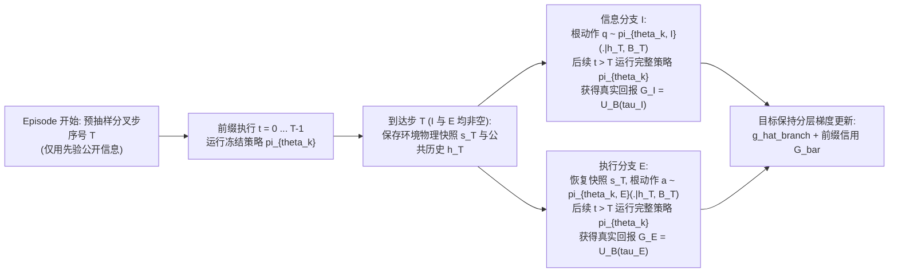

# PRISM-Evolve：基于同前缀双分支分层交互采样与目标保持策略更新的自演化长时程智能体设计方案

> **2026-11-05 实验协议修订**：依据用户最新精简授权，当前执行以 [native-v1 原生环境协议](native-experiment-protocol.md) 的 `prism-native-focused-20261105` 矩阵为准，覆盖本文 §7.2–§7.3 的执行范围及旧实验安排。Host A 的 Llama3.1-8B 与 Host B 的 Qwen2.5-7B 保留完整主比较，SPAR 的 Unweighted/Unstratified 自身消融仅在 7B 进行；普通 PG/Value/RLOO、27B 和额外敏感度扫描退出本轮。各方法统一使用预算终点 checkpoint，反馈诊断仅比较 7B SPAR 初始与最终参数在少量固定开发锚点上的变化。共 144 个正式测试单元、48,600 回合。§3–§5 的效用与分层更新公式保持；旧结果及中断记录原样保留，新实验由 A/B 使用独立目录执行。

> **文档定位与架构演进说明**
> 本文档确立了从原 `PRISM-Exact`（基于统一有限世界生成先验与全分支精确推断）向 **`PRISM-Evolve`**（基于真实交互持续更新参数、同时学习信息获取与后续执行的自演化智能体）的完整重构方案。
> - **保留的核心资产**：联合证据意识、公共历史可测性约束、不可变事件记录与真实全链路成本计量；原 `PRISM-Exact` 的闭合乘积-似然比推断与商空间约简退居为受控小规模诊断模块。
> - **退出主架构的重型假设**：统一有限世界匿名生成先验（`shared-typed-reference-v1` 全宇宙枚举）、在线全分支精确因子图推断与割集消元、人为规定衰减率的动作创新模型（$F_{\text{scope}}, \phi_g, I_\kappa$ 及均匀失败转移核）。
> - **核心科学问题**：**在有限交互预算下，如何让智能体持续经历“获得新信息以后能够做得更好”的真实过程，并把这些经历通过跨任务参数更新转化为下一项未知任务中的主动探路能力？**

---

## 目录

1. [原方案（PRISM-Exact）核心逻辑审查与重构依据](#1-原方案prism-exact核心逻辑审查与重构依据)
2. [PRISM-Evolve 研究对象、核心假设与有限样本理论依据](#2-prism-evolve-研究对象核心假设与有限样本理论依据)
3. [统一任务效用、真实成本语义与单策略双模式分解](#3-统一任务效用真实成本语义与单策略双模式分解)
4. [核心训练算子：同一公共前缀下的双分支真实续跑与目标保持更新](#4-核心训练算子同一公共前缀下的双分支真实续跑与目标保持更新)
5. [理论保证：目标无偏性、根门控方差优势定理与精确有理数枚举核验](#5-理论保证目标无偏性根门控方差优势定理与精确有理数枚举核验)
6. [自演化机制与遮蔽反馈诊断算子（$\Delta_{\mathrm{use}}$）](#6-自演化机制与遮蔽反馈诊断算子delta_mathrmuse)
7. [创新定位、相关工作边界与精简实验设计（AppWorld + PlanBench-XL）](#7-创新定位相关工作边界与精简实验设计appworld--planbench-xl)
8. [六模块工程架构与三阶段执行路线图](#8-六模块工程架构与三阶段执行路线图)

---

## 1. 原方案（PRISM-Exact）核心逻辑审查与重构依据

对原方案八层架构的第一性原理审查表明，必须将“局部成立的代数性质”与“不适应开放环境的强人为先验”严格剥离：

### 1.1 联合后验代数可保留，但“共享前提同向下调”存在严格反例

1. **成立的局部代数性质**：
   原方案第 2.3 节中二元合取指示器 $\theta_e = \prod_{i \in e} \theta_i$ 的幂等似然合并恒等式：
   $$(1 + \eta \theta_e)(1 + \delta \theta_e) = 1 + (\eta + \delta + \eta \delta)\theta_e$$
   以及第 2.4 节的连通分量分解、第 2.5 节被测路线自身的赔率衰减 $O_{t+1}(E_k) = \Lambda_e(y) O_t(E_k)$，在因子图完整表达联合分布且事件身份建模正确时严格成立。
2. **“共享前提必然同步下调”的反例与一般协方差律**：
   原方案第 2.5 节断言“共享部分前提的路线在阴性反馈后必然按正相关性同步下调”，这一结论在已有历史负证据时**不成立**。
   - **精确反例**：设 $\theta_1, \theta_2, \theta_3 \in \{0,1\}$ 初始独立均匀，且历史已观察到互斥约束 $\theta_1 \theta_2 = 0$（后验在其余 6 个状态上均匀分布）。考察共享前提 $\theta_3$ 的两条路线：
     $$E_{13} = \{\theta_1 \theta_3 = 1\}, \qquad E_{23} = \{\theta_2 \theta_3 = 1\}$$
     此时 $P(E_{13}) = P(E_{23}) = 1/6$，且 $E_{13} \cap E_{23} = \emptyset$。若对 $E_{13}$ 观测到阴性反馈 $y = 0$（似然比 $\Lambda = 1/5$），则精确后验为：
     $$P(E_{23} \mid y = 0) = \frac{1/6}{1 - (4/5)(1/6)} = \frac{5}{26} > \frac{1}{6}$$
     共享前提 $\theta_3$ 的路线 $E_{23}$ 的存活概率反而**上升**了！
   - **一般更新公式**：任意路线 $E_j$ 在观测路线 $E_k$（似然比 $\Lambda$）后的精确概率变化由当前联合后验中的**协方差**决定：
     $$P'(E_j) - P(E_j) = \frac{(\Lambda - 1)\operatorname{Cov}\!\left(\mathbf{1}_{E_j}, \mathbf{1}_{E_k}\right)}{1 + (\Lambda - 1)P(E_k)}$$
     当历史失败使两条共享前提的路线成为相互竞争的替代解释时，$\operatorname{Cov}(\mathbf{1}_{E_j}, \mathbf{1}_{E_k}) < 0$，进一步证伪其一反而会提升另一解释的可信度。
   - **重构启示**：不能用“属于同一人工操作族”硬编码同向惩罚；经验更新必须保留具体上下文与真实后续结果，直接从真实交互历史中学习动作价值与行为调整。

### 1.2 信息价值取决于后续行为改变，而非在线展开显式搜索树深度

1. **原方案叶子求值对“必须 $d \ge 2$ 才有正信息价值”的反例**：
   设隐藏状态等概率为 $A$ 或 $B$，两条终端路线分别在 $A, B$ 下成功。先验下最优叶子策略价值为 $L(b) = \max\{P(A), P(B)\} = 1/2$。若仅展开一步完全揭示状态的探针，后验叶子价值期望即达 $\mathbb{E}_o[L(b_o)] = 1 > 1/2$。
2. **第一性原理结论**：
   **信息的任务价值来自后续策略能够利用新观测改变后续行为**。只要历史条件策略 $\pi_\theta(a \mid h_t, B_t)$ 通过训练学会了长距离的“探测—解释—执行—恢复”映射，部署时直接进行单步策略推理即可主动选择信息获取动作，无需在测试期在线展开指数级爆炸的多步贝尔曼搜索树。

### 1.3 机制有效性 $C_a = 0$ 与均匀失败转移核之间的逻辑断裂

1. **原方案第 5.3 / 5.5 节的行为悖论**：
   原方案一方面规定已确认失效（$C_a = 0$）的同一规范动作 $\kappa$ 再次执行时机制有效概率为 $0$；另一方面又在无原子回滚契约时规定 $C_a = 0$ 的失败后继在合法后继集 $\mathcal{L}_0(X)$ 上均匀采样。
   - **反例**：考虑二元目标状态 $X = 1$，当前 $X = 0$，合法后继集 $\mathcal{L}_0(X) = \{0, 1\}$。即便某动作已 100% 确认机制失效（$C_a = 0$）且上次碰巧返回 $X = 0$（读取状态未变，规范键 $\kappa$ 不变），按均匀失败核再次执行该死动作仍有 $1/2$ 的概率直接跳到目标 $X = 1$！这使得以目标成功率为优化对象的规划器依然会主动重复已知失效的动作。
   - 同时，第 5.4 节将新补丁身份生成概率规定为仅随尝试次数下降的 $\approx 1/(n+1)$，完全忽略了报错内容、故障定位进展与构造器能力变化。
2. **重构处理**：
   彻底删除人为设定的失败均匀核、固定创新概率网格和 $1/4 \to 1/12$ 操作族衰减律，**直接使用环境真实状态转移与真实终局结果**。

### 1.4 状态充分性缺口与语义前端单事件内部双重计票

1. **状态充分性缺口**：真实状态 $S = (X, D)$ 包含具体代码与工件 $D$，但转移核 $K(X', o \mid \Theta, X, a)$ 仅条件于有限关系层 $X$。两份同样表现为“测试失败”（相同 $X$）的不同代码（不同 $D$）在接受同一补丁后未来分布截然不同，$X$ 不具备马尔可夫充分性。
2. **单事件内部证据重复计票**：原方案第 4.5 节的字段关联报告 $R$ 与第 6.2 节的整体语义报告 $\hat{c}$ 提取自同一份 LLM 编译输出，二者存在强统计依赖甚至确定性耦合，将 $P(R \mid C, f, s)$ 与 $J(\hat{c} \mid \Gamma, A, M)$ 作为独立因子相乘会在单个事件内部重复放大同一份 LLM 输出证据。
3. **重构处理**：策略直接以包含可见工件、反馈与剩余预算的**公共历史 $h_t = (g, o_0, a_0, o_1, \dots, a_{t-1}, o_t)$** 为输入；上下文编码器承担表征学习，机械接口仅负责引用、格式与执行合法性校验。

### 1.5 其余模块审查汇总与实验基准事实修正

| 原方案模块 | 审查结论 | PRISM-Evolve 最终处理 |
| :--- | :--- | :--- |
| 第 2.2 节一阶参数 $r_i$ | 引入高阶因子后，$r_i$ 仅为一阶势参数，不再等于真实边际赔率 | 在局部推断诊断附录中更正术语定义 |
| 第 2.6 节保测柱面扩展 | 仅适用于旧似然不变的延迟实例化；若新增原因解释了旧失败，旧变量后验理应改变 | 仅保留为局部代数性质 |
| 第 3 节统一匿名先验与 $S_{1024}$ 商约简 | 类型均匀、集中度 $=1$ 属于强人为归纳偏置；商约简需严格区分变量身份等价与名义类型等价 | 从主系统移除全宇宙枚举，仅保留于受控诊断模块 |
| 第 4.2 节目录持久排序 | 首次前缀概率不能直接作为后续分页请求的独立似然重复相乘 | 主系统直接读取真实检索结果，不建排序生成先验 |
| 第 6.4 节事件身份与第 9.3 节 WAL | 相同输入的两次动态执行属于不同证据事件；外部副作用到回执落盘间仍依赖执行端契约 | 分别记录执行发生 ID（Occurrence ID）、工件版本与内容哈希，保持轻量公共事件日志 |
| 第 7–8 节割集推断与字典序目标 | 割集条件化仅省内存不省指数时间；字典序目标对微小成功率差异无限敏感而忽视正常时间开销 | 部署期移除全分支树搜索，采用统一的成功时间面积效用 $U_B(\tau)$ |
| 第 9.2 节实验基准事实 | PlanBench-XL 官方发布为 `retail` 单域（327 queries, 56 datatypes, 1,665 tools）；SWE-bench Lite 含 300 test / 23 dev；三环境拼凑 50 题混杂适配器噪声 | **主环境采用 AppWorld**（9 应用、457 API、750 任务，原生支持快照保存/恢复）；**第二环境采用 PlanBench-XL** |

---

## 2. PRISM-Evolve 研究对象、核心假设与有限样本理论依据

### 2.1 跨任务自演化智能体形式化

研究对象是面对一系列未知任务的智能体序列：

$$
\mathcal{A}_k = \bigl(\pi_{\theta_k},\; \mathcal{H}_k\bigr), \qquad k = 0, 1, 2, \dots
$$

- $\mathcal{H}_k$ 是第 $k$ 个任务实例运行期间的**任务内公共交互历史**：
  $$h_t = (g, o_0, a_0, o_1, \dots, a_{t-1}, o_t)$$
  每当新任务开始时，环境实例与任务内对话历史 $\mathcal{H}_k$ **完全清空重置**；
- $\theta_k$ 是**跨任务持久保留的可训练策略参数**（如基座模型上的持久可训练适配器参数）。智能体通过自身动作采集真实环境交互轨迹，利用原生终局结果更新参数：
  $$\theta_k \;\longrightarrow\; \text{双分支真实交互经历} \;\longrightarrow\; \mathcal{D}_k \;\longrightarrow\; \theta_{k+1}$$
- **自演化能力判据**：阶段策略 $\pi_{\theta_k}$ 必须在**清空上下文历史后的未见新任务（Held-out Tasks）**上表现出信息获取质量、观测利用质量、失败恢复质量与终局成功效用的持续提升。

### 2.2 核心研究假设与有限样本稀缺性定理

> **主研究假设**：
> 当前策略的信息获取概率 $p_\theta(h)$ 直接限制了训练中“信息分支经验”的出现频率。对选定公共前缀进行**信息（Information）**与**执行（Execution）**两类真实分支的分层采样（Stratified Sampling），能够克服有限交互预算下的信息经验饥饿；结合严格保持原任务目标的概率加权梯度算子，智能体能够将“获得新信息后做得更好”的真实对比经历转化为跨任务的主动探路能力。

**有限样本依据**：
设在某个需要探路的公共历史前缀 $h$ 上，当前尚未成熟的策略选择信息获取动作的总概率仅为 $p(h) \in (0, 1)$。若采用普通同策略采样（如标准 Outcome RL 或普通 RLOO）独立采样 $n$ 条续跑轨迹，则**一条信息分支都未出现**的概率为：

$$
P(N_I = 0 \mid h) = \bigl(1 - p(h)\bigr)^n
$$

例如当 $p(h) = 0.02$、每个前缀允许 $n = 2$ 次续跑时，$P(N_I = 0 \mid h) = (0.98)^2 = \mathbf{96.04\%}$！这意味着在超过 $96\%$ 的训练采集中，智能体根本没有机会经历“如果当时先查一下文档或跑个只读检查，后续能否避免失败并成功完成任务”，从而陷入训练期的**经验自锁**。PRISM-Evolve 直接在数据采集算子层面对这一瓶颈进行精确干预。

---

## 3. 统一任务效用、真实成本语义与单策略双模式分解

### 3.1 统一任务效用函数 $U_B(\tau)$（成功时间面积）

设 $\tau$ 为一条从任务开始到终止的完整交互轨迹：
- $Y(\tau) \in \{0, 1\}$ 为环境原生判定器给出的终局任务成功指示器（仅当正式调用 `submit` 且通过环境终局验证时才可能为 $1$；中间测试通过或工具返回成功码仅作为公共观测，不计入 $Y$）；
- $C(\tau) \ge 0$ 为从任务开始到正式提交的累计真实耗时（包含工具执行等待、模型推理耗时及恢复开销）；
- $B > 0$ 为预先规定的单任务时间预算上限（同时每个 episode 设有相同的工具调用步数与 token 硬上限）。

**主训练与评价效用定义**为：

$$
U_B(\tau) \triangleq Y(\tau)\left(1 - \frac{C(\tau)}{B}\right)_+ = \frac{1}{B} \int_0^B \mathbf{1}\bigl\{\text{任务在时刻 } u \text{ 前已成功提交}\bigr\}\,du \;\in\; [0, 1]
$$

**物理意义**：
1. $U_B(\tau)$ 精确等于任务在预算窗口 $[0, B]$ 内的**归一化成功时间面积（Normalized Area Under Success-Over-Time）**；
2. 它在不引入字典序不连续跳变的前提下，将“是否成功（$Y$）”与“完成速度（$C/B$）”统一到单一标量效用中：真正有助于排障的探针通过提高 $Y(\tau)$ 或减少盲目试错耗时来提升 $U_B(\tau)$；而冗余、无效的探索则会因白白增加 $C(\tau)$ 自然降低回报。
3. 实验同时独立报告**原生成功率 $\mathbb{E}[Y(\tau)]$** 与**成功时间效用 $\mathbb{E}[U_B(\tau)]$**。

### 3.2 单一策略中的两类动作模式分解（$I$ vs. $E$）

沿用公共动作意图，将当前历史 $h$ 下合法的候选动作划分为两个互斥条件集合：

$$
I = \{\texttt{discover},\; \texttt{probe}\}, \qquad E = \{\texttt{execute},\; \texttt{submit}\}
$$

- **信息动作集 $I$**：优先由环境公开标明的文档/API 目录检索（`discover`）与只读状态查询/无副作用检查接口（`probe`）构成；
- **执行动作集 $E$**：由改变环境状态的业务操作调用（`execute`）与正式终止提交（`submit`）构成（注：$E$ 中的动作同样会产生观测反馈，其实际信息收益自然计入完整轨迹回报）。

在用户确认的原生文本环境扩展中，动作类别按公开接口的主要意图预先划分。家居交互环境将 `look`、`inventory`、`examine`、`go to`、`open` 归入 $I$，将拿取、放置、加工、使用及关闭等动作归入 $E$；ClinDiag 的病史、查体及检查查询归入 $I$，诊断提交归入 $E$。这一扩展允许信息动作改变位置、容器或会话状态，并不把这些动作声明为无副作用查询。分类不得使用隐藏答案或事后结果；分支必须从相同物理状态和公共历史恢复，实际状态变化与成本均予以保留。原有 AppWorld 和 PlanBench-XL 接口的分类不因这一扩展改变。

同一个策略网络 $\pi_\theta$（共享同一个底模与同一个可训练适配器）对任意历史 $h$ 与剩余预算状态 $B$ 先输出**模式门控概率**：

$$
p_\theta(h, B) \triangleq P_\theta(m = I \mid h, B) \in (0, 1)
$$

再在对应模式下生成具体动作的条件分布 $\pi_{\theta, I}(a \mid h, B)$（$a \in I$）与 $\pi_{\theta, E}(a \mid h, B)$（$a \in E$）。因此，完整部署策略的动作概率严格分解为：

$$
\pi_\theta(a \mid h, B) = \begin{cases}
p_\theta(h, B)\,\pi_{\theta, I}(a \mid h, B), & a \in I, \\[6pt]
\bigl(1 - p_\theta(h, B)\bigr)\,\pi_{\theta, E}(a \mid h, B), & a \in E.
\end{cases}
$$

- **零额外推理网络开销**：模式选择 $m \in \{I, E\}$ 直接作为受约束输出格式（Constrained Decoding）的首选合法标记实现，无需额外部署独立的价值网络或规划器。
- **部署期纯单轨运行**：在评估与实际部署时，模型直接按 $\pi_\theta(a \mid h_t, B_t)$ 采样或贪心解码动作，读取真实环境反馈并推进单条轨迹，不使用任何环境快照回滚。

---

## 4. 核心训练算子：同一公共前缀下的双分支真实续跑与目标保持更新

### 4.1 在线前缀选定与双分支真实续跑（Branch Collector）

在每条训练 episode 中，分支采集器按以下严格非神谕规程生成训练数据：

1. **非神谕分叉步选定**：每个训练 episode 最多选择一个分叉时刻 $T$。$T$ 在根动作发生前确定（例如在 episode 开始时随机抽取允许的决策步序号）；若任务在到达 $T$ 前已自然终止，则按普通单轨迹更新。
2. **环境快照保存与独立条件采样**：
   当轨迹到达步 $T$ 且当前状态下 $I$ 与 $E$ 两类合法动作均非空时，数据收集器保存当前环境运行物理状态快照 $s_T$（涵盖数据库、文件系统、虚拟时间与会话上下文）及公共历史 $h_T$。保持当前轮策略参数 $\theta_k$ 冻结，使用独立随机数分别采样两类根动作并续跑到底：
   - **信息分支 $I$**：采样并执行根动作 $q \sim \pi_{\theta_k, I}(\cdot \mid h_T, B_T)$，读取真实反馈后，在 $t > T$ 的所有后续步骤中**无约束地运行完整策略 $\pi_{\theta_k}$**（可继续探测、执行、恢复直至终止），得到完整轨迹 $\tau_I$ 与真实回报 $G_I = U_B(\tau_I)$；
   - **执行分支 $E$**：从快照 $s_T$ 精确恢复环境物理状态与公共历史 $h_T$，采样并执行根动作 $a \sim \pi_{\theta_k, E}(\cdot \mid h_T, B_T)$，读取真实反馈后，在 $t > T$ 的所有后续步骤中同样**无约束地运行完整策略 $\pi_{\theta_k}$**，得到完整轨迹 $\tau_E$ 与真实回报 $G_E = U_B(\tau_E)$。
3. **严格的训练/策略隔离边界**：
   环境快照 $s_T$ 仅由训练数据收集器持有以恢复物理分支，策略模型 $\pi_\theta$ 只能读取各自的公共历史 $h_t^I$ 或 $h_t^E$；训练器绝不利用未来结果替模型挑选根动作，也绝不把后见之明写回历史。

### 4.2 目标保持的分层策略梯度估计器与损失函数

由于训练期在步 $T$ 强制以 $1:1$ 采集了 $I$ 与 $E$ 两条分支（改变了原始类别频率 $p$ 与 $1-p$），更新算子必须显式结合部署策略自身的门控概率 $p = p_{\theta_k}(h_T, B_T)$ 进行重要性配平。

定义信息分支与执行分支在分叉步及之后的对数概率和（**注意：根部仅计入条件动作概率 $\pi_{\theta, I}$ 或 $\pi_{\theta, E}$，不重复计入根门控 $p_\theta$**）：

$$
\ell_I(\theta) \triangleq \log \pi_{\theta, I}(q \mid h_T, B_T) + \sum_{t > T} \log \pi_\theta\bigl(a_t^I \mid h_t^I, B_t^I\bigr)
$$

$$
\ell_E(\theta) \triangleq \log \pi_{\theta, E}(a \mid h_T, B_T) + \sum_{t > T} \log \pi_\theta\bigl(a_t^E \mid h_t^E, B_t^E\bigr)
$$

并记分叉前公共前缀（$0 \le t < T$）的对数概率和为：

$$
\ell_{\mathrm{pre}}(\theta) \triangleq \sum_{t = 0}^{T - 1} \log \pi_\theta(a_t \mid h_t, B_t)
$$

1. **分叉处及后继轨迹的分层梯度估计器**：
   $$\boxed{\widehat{g}_{\mathrm{branch}} = (G_I - G_E)\nabla_\theta p_\theta(h_T, B_T) \;+\; p\,(G_I - G_E)\nabla_\theta \ell_I(\theta) \;+\; (1 - p)\,(G_E - G_I)\nabla_\theta \ell_E(\theta)}$$
   - **第一项 $(G_I - G_E)\nabla_\theta p_\theta$**：直接用同前缀下两条真实续跑的终局效用差，驱动当前历史下模式门控向更高收益的一侧移动；
   - **第二项 $p(G_I - G_E)\nabla_\theta \ell_I$**：以执行分支回报 $G_E$ 为天然状态条件基线，训练具体的信息查询动作 $q$ 以及获得新信息后的全链条使用行为；
   - **第三项 $(1 - p)(G_E - G_I)\nabla_\theta \ell_E$**：以信息分支回报 $G_I$ 为天然基线，训练直接执行动作 $a$ 及其后续恢复行为。
2. **分叉前公共前缀的期望回报信用分配**：
   对于 $t < T$ 已发生的动作，其条件无偏回报为两分支的部署概率加权均值：
   $$\bar{G} \triangleq p\,G_I + (1 - p)\,G_E$$
   减去与当前轨迹抽样独立的批次均值基线 $b_k$（无需训练额外价值网络）。
3. **可直接实现的单次反传损失函数 $\mathcal{L}_k(\theta)$**：
   令 $\operatorname{sg}(\cdot)$ 表示停止梯度算子（`stop_gradient` / `.detach()`），则单条分叉数据的完整损失函数为：
   $$
   \begin{aligned}
   \mathcal{L}_k(\theta) ={}& -\operatorname{sg}(\bar{G} - b_k)\,\ell_{\mathrm{pre}}(\theta) \\
   &-\operatorname{sg}(G_I - G_E)\,p_\theta(h_T, B_T) \\
   &-\operatorname{sg}\!\bigl(p\,(G_I - G_E)\bigr)\,\ell_I(\theta) \\
   &-\operatorname{sg}\!\bigl((1 - p)\,(G_E - G_I)\bigr)\,\ell_E(\theta)
   \end{aligned}
   $$
   **实现不变量**：所有回报项与作为加权系数的 $p = p_{\theta_k}(h_T, B_T)$ 均严格停止梯度；显式门控项单独对 $p_\theta(h_T, B_T)$ 反传；每个实际发生的动作 token 序列的对数似然（score）在计算图中**严格只计算一次**。训练采用 on-policy 分批模式：冻结 $\theta_k$ 采集一批双分支轨迹 $\to$ 执行一次参数更新得到 $\theta_{k+1}$ $\to$ 采集下一批。

---

## 5. 理论保证：目标无偏性、根门控方差优势定理与精确有理数枚举核验

### 5.1 定理 5.1：分层更新对原部署策略目标的严格无偏性

**定理 5.1（目标保持性）**：条件于分叉处的公共历史 $h_T$ 与真实环境物理快照 $s_T$，定义信息分支与执行分支的真实条件期望价值为：

$$
V_I \triangleq \mathbb{E}[G_I \mid h_T, s_T], \qquad V_E \triangleq \mathbb{E}[G_E \mid h_T, s_T]
$$

则当前部署策略 $\pi_\theta$ 从 $(h_T, s_T)$ 出发的真实期望价值为 $J_{h_T, s_T}(\theta) = p_\theta V_I(\theta) + (1 - p_\theta) V_E(\theta)$，且分层梯度估计器 $\widehat{g}_{\mathrm{branch}}$ 严格满足：

$$
\mathbb{E}\bigl[\widehat{g}_{\mathrm{branch}} \;\big|\; h_T, s_T\bigr] = \nabla_\theta J_{h_T, s_T}(\theta)
$$

**证明概要**：
由乘积求导法则，真实价值梯度分解为：

$$
\nabla_\theta J_{h_T, s_T}(\theta) = (V_I - V_E)\nabla_\theta p_\theta + p_\theta \nabla_\theta V_I + (1 - p_\theta)\nabla_\theta V_E
$$

由于两条分支在给定快照 $(h_T, s_T)$ 后使用独立随机数采样，$G_E$ 与 $\nabla_\theta \ell_I$ 条件独立，且得分函数恒满足 $\mathbb{E}[\nabla_\theta \ell_I \mid h_T, s_T] = \mathbf{0}$。因此对方分支的回报构成合法的零均值控制变量（Baseline）：

$$
\mathbb{E}[G_E \nabla_\theta \ell_I \mid h_T, s_T] = \mathbb{E}[G_E \mid h_T, s_T] \cdot \mathbb{E}[\nabla_\theta \ell_I \mid h_T, s_T] = \mathbf{0}
$$

同理 $\mathbb{E}[G_I \nabla_\theta \ell_E \mid h_T, s_T] = \mathbf{0}$。结合策略梯度恒等式 $\mathbb{E}[G_I \nabla_\theta \ell_I \mid h_T, s_T] = \nabla_\theta V_I$ 与 $\mathbb{E}[G_E \nabla_\theta \ell_E \mid h_T, s_T] = \nabla_\theta V_E$，对 $\widehat{g}_{\mathrm{branch}}$ 取条件期望即得 $\nabla_\theta J_{h_T, s_T}(\theta)$。门控 $p_\theta$ 与条件策略 $\pi_{\theta, I}, \pi_{\theta, E}$ 共享底层参数完全不影响该线性期望分解。$\blacksquare$

### 5.2 定理 5.2：根门控梯度的方差缩减定理（对比双样本 RLOO）

设 $D \triangleq G_I - G_E$，$u \triangleq p(1 - p) \in (0, 1/4]$，且门控概率由 logit 参数 $\alpha$ 通过 sigmoid 函数 $p = \sigma(\alpha)$ 参数化（满足 $\frac{\partial p}{\partial \alpha} = p(1 - p) = u$）。
- **分层双分支估计器**在门控 logit $\alpha$ 上的梯度估计为：
  $$\widehat{g}_{\alpha, \mathrm{strat}} = u\,D = u\,(G_I - G_E)$$
- **普通双样本 RLOO（Leave-One-Out）**从完整策略 $\pi_\theta$ 独立采样两条轨迹 $(G_1, I_1)$ 与 $(G_2, I_2)$（其中 $I_i \in \{0, 1\}$ 为根动作落入信息集 $I$ 的指示器），其门控 logit 梯度估计为：
  $$\widehat{g}_{\alpha, \mathrm{RLOO}} = \frac{1}{2}(G_1 - G_2)(I_1 - I_2)$$

**定理 5.2（根门控方差严格占优）**：条件于相同的 $(h_T, s_T)$，$\widehat{g}_{\alpha, \mathrm{strat}}$ 与 $\widehat{g}_{\alpha, \mathrm{RLOO}}$ 具有完全相同的条件期望 $u(V_I - V_E)$，且其方差之差严格非负：

$$
\boxed{\operatorname{Var}\bigl(\widehat{g}_{\alpha, \mathrm{RLOO}} \mid h_T, s_T\bigr) - \operatorname{Var}\bigl(\widehat{g}_{\alpha, \mathrm{strat}} \mid h_T, s_T\bigr) = u\left(\frac{1}{2} - u\right)\mathbb{E}\bigl[D^2 \mid h_T, s_T\bigr] \ge 0}
$$

由于对任意 $p \in (0, 1)$ 恒有 $u = p(1-p) \le 1/4 < 1/2$，只要两类分支存在非零回报差异（$\mathbb{E}[D^2] > 0$），分层估计器在根门控上的方差**严格小于**双样本 RLOO！直观原因在于：普通采样的两条轨迹有 $p^2 + (1-p)^2 = 1 - 2u \ge 50\%$ 的概率落入同一动作类别（导致 $I_1 - I_2 = 0$，门控梯度信号完全丢失），而分层采样 100% 形成跨类别真实结果对比。

### 5.3 有限两阶段环境的精确有理数枚举基准（单元测试黄金真值）

以下精确有理数枚举算例作为参数更新器（Module 5）实现的强制性数值核验基准：
- **环境设定**：隐藏状态等概率；信息分支揭示真实状态，其后继猜对概率为 $0.8$，总耗时成本为 $0.3B$（故 $G_I = 0.7 Y_I$）；执行分支不揭示状态，平均猜对概率为 $0.5$，总耗时成本为 $0.2B$（故 $G_E = 0.8 Y_E$）。
- **当门控概率 $p = 0.4$ 时**：
  - 部署策略期望效用精确值：
    $$J = 0.4 \times 0.7 \times 0.8 + 0.6 \times 0.8 \times 0.5 = 0.224 + 0.240 = \mathbf{0.464}$$
  - 按（门控 logit、信息使用 logit、无信息猜测 logit）排列的解析真值梯度与分层估计器精确枚举均值完全一致：
    $$\nabla J = \bigl(\mathbf{0.0384},\; \mathbf{0.0448},\; \mathbf{0.0}\bigr)$$
  - 全梯度方差与期望成本对比：

| 诊断指标 | 分层双分支（PRISM-Evolve） | 普通双样本 RLOO |
| :--- | :--- | :--- |
| **全梯度方差之和** $\sum_i \operatorname{Var}(\widehat{g}_i)$ | $\mathbf{0.0395168}$ | $0.0711904$ |
| **每对轨迹期望时间成本** | $0.50\,B$ | $0.48\,B$ |
| **方差 $\times$ 期望成本乘积** | $\mathbf{0.0197584\,B}$ | $0.034171392\,B$ |

> **方法诚实边界说明**：在极端低门控概率（如 $p = 0.02$）下，虽然分层采样大幅改善了信息分支的经验覆盖率，但经全梯度（含后继参数）与成本折算后，相对 RLOO 的方差优势会收窄，且普通无基线双样本估计在该特定点可能具有更低的总方差。因此，正式实验必须在开发集（`dev`）上从普通策略梯度、价值基线或 RLOO 中选出表现最强的实现作为公平对照基线。

---

## 6. 自演化机制与遮蔽反馈诊断算子（$\Delta_{\mathrm{use}}$）

### 6.1 跨任务自演化如何涌现主动探路能力

以跨应用交互任务（如 AppWorld 中的账户/实体映射消歧）为例：
1. **初始阶段（盲目执行受挫）**：表面相似的记录可能对应不同底层实体 ID。初始策略 $\pi_{\theta_0}$ 倾向于直接执行修改操作（$m = E$），触发对象不匹配或误改附带状态，导致终局失败 $G_E = 0$。
2. **双分支真实对比经历**：在选定前缀 $h_T$ 上，信息分支 $I$ 先调用只读查询接口核实映射（支付少量时间成本 $\Delta C$），在公共历史中暴露出真实实体 ID，后续策略据此完成正确操作获得 $G_I > 0$；执行分支 $E$ 沿原判断盲目执行获得 $G_E = 0$。
3. **三路协同参数更新**：正向回报差 $G_I - G_E > 0$ 通过 $\mathcal{L}_k(\theta)$ 同时强化：
   - **何时该查**（门控项 $\nabla_\theta p_\theta$ 在存在歧义的上下文模式上上调信息模式概率）；
   - **怎么查与查完怎么用**（条件信息项 $p(G_I - G_E)\nabla_\theta \ell_I$ 强化精准查询参数与读取返回结果后的条件执行动作）。
4. **自适应停止冗余探测**：反之，当任务初始提示或前置历史中映射已经明确无误时，额外查询纯属浪费时间（$C(\tau_I) > C(\tau_E)$ 且 $Y(\tau_I) = Y(\tau_E) = 1 \implies G_I < G_E$），此时 $G_I - G_E < 0$ 自然压低不必要探测的概率。

### 6.2 遮蔽反馈开发诊断算子 $\Delta_{\mathrm{use}}(\pi)$

为独立定量诊断当前策略“是否真正读懂并利用了探针返回的反馈信息”，在预先固定的少量开发集前缀上定义**遮蔽反馈诊断量**：

$$
\Delta_{\mathrm{use}}(\pi) \triangleq \mathbb{E}\bigl[U_{\mathrm{visible}}(\pi) - U_{\mathrm{masked}}(\pi)\bigr]
$$

- **构造方式**：从同一信息动作 $q \in I$ 执行后的**同一个后继物理状态**出发，保留完全相同的已付时间成本：
  - **可见分支（`visible`）**：公共历史正常包含动作 $q$ 的真实返回内容；
  - **遮蔽分支（`masked`）**：仅将本次动作 $q$ 的返回负载文本替换为机械占位符（后续仍允许策略通过正常动作重新查询并支付额外成本）。
- **严格的职责边界**：$\Delta_{\mathrm{use}}(\pi)$ 仅用于开发集（`dev`）的小规模机制诊断（监控随着训练推进，模型利用新反馈的能力是否增长），**绝不加入训练奖励函数，不构建额外校准模块，也不增加部署期步骤**。

---

## 7. 创新定位、相关工作边界与精简实验设计（AppWorld + PlanBench-XL）

### 7.1 创新定位与相关工作清晰边界

| 邻近工作方向 | 代表工作 | 核心机制 | PRISM-Evolve 的严格区别与定位 |
| :--- | :--- | :--- | :--- |
| **轨迹经验蒸馏 / 反思强化** | EvolveR, SEED | 将历史轨迹提炼为自然语言原则经验或蒸馏后见技能变化 | 不依赖显式文本原则库或后见答案注入，直接通过同前缀真实双分支交互算子更新持久策略参数 |
| **信息感知信用分配 / 内在奖励** | AREW, InfoPO | 使用方向性批评重分配学习信号，或用可见/遮蔽反馈下的动作 KL 散度构造内在信息奖励 | **不修改任务奖励函数**（零内在信息奖励塑造）；通过分层采样解决有限样本下的信息分支覆盖瓶颈，并保持原部署目标严格无偏 |
| **反事实分支续跑强化学习** | CVT-RL | 使用冻结后继策略进行反事实续跑，结合干预有效性估计与复杂约束 | 聚焦于“信息获取 $I$ vs. 直接执行 $E$”的二元模式稀缺性矛盾，导出极简无偏梯度公式与根门控方差优势定理 |

### 7.2 主环境与第二环境数据协议

1. **第一主环境：AppWorld（完整闭环主实验）**
   - **环境特征**：涵盖 9 个日常与办公应用、457 个 API 和 750 项多步交互任务，包含可变后台数据库状态、复杂跨应用实体依赖与严格的原生终局状态评测器。
   - **接口与快照协议**：采用标准 API / function calling 接口，公共中间返回值保存在可序列化历史 $h_t$ 中。训练器利用 AppWorld 原生状态保存与恢复接口（覆盖数据库、时间、会话与运行上下文）在选定前缀 $T$ 执行双分支续跑；**正式评测（`dev` / `test`）严格禁用任何快照回滚，沿单条真实轨迹执行到底**。
   - **数据划分铁律**：参数训练仅使用官方 `train` 集；超参数选择、基线对比选型（普通 PG / Value Baseline / RLOO）与 $\Delta_{\mathrm{use}}$ 诊断仅使用 `dev` 集；最终在 `test` 集上冻结策略参数，仅运行一次并报告官方汇总得分（严禁利用 `test` 集逐题报告进行错误分析或调参）。
2. **第二复验环境：PlanBench-XL（主动目录检索与长工具链泛化）**
   - **环境特征**：官方发布版包含 `retail` 域 327 个复杂查询、56 种数据类型与 1,665 个候选工具。
   - **复验目的**：沿用与 AppWorld 完全相同的双模式策略结构 $\pi_\theta$ 与双分支分层更新算子 $\mathcal{L}_k(\theta)$，仅替换底层环境适配器接口，检验主动工具检索（`discover`）与长链参数传递下的跨任务自演化收益。（注：`SWE-bench Lite` 与 `AIOpsLab` 暂不进入第一轮主体实验。）

### 7.3 主比较基线、核心消融与成功判据（单篇顶会论文实验方案）

为严格控制实验规模在单篇顶会论文的一张主对比表 + 一张机制消融表之内，实验围绕 **AppWorld（主环境）+ PlanBench-XL（跨环境泛化复验）**，按“每个核心竞争流派仅选取 1 个最具代表性且拥有官方开源仓库的 2025–2026 同行评审方法”构建主表，并直接复用已完成的内部组件消融与理论核验结果：

#### 1. 论文主实验对比表（Main Table：5 个 2025–2026 顶会开源代表基线 vs. PRISM-Evolve）

所有方法共享同一策略底座、同一训练交互预算（Iso-Step）与同一测试期单轨预算 $B$（零测试期回滚）：

| 对标维度（每流派 1 个代表） | 选定 2025–2026 顶会基线 | 论文与官方开源仓库（附固定 Commit） | 核心机制与对标论证作用 |
| :--- | :--- | :--- | :--- |
| **0. 基础参照底座** | **`Frozen Base` / `PlanBench-XL Official`** | **EMNLP 2026 Main** ([arXiv:2606.22388](https://arxiv.org/abs/2606.22388)) [`JiayuJeff/PlanBench-XL`](https://github.com/JiayuJeff/PlanBench-XL) (`a24bfd5`) | 冻结初始参数 $\theta_0$ 的标准 ReAct + 增量工具检索智能体，提供自演化净收益 $\Delta_{\mathrm{evo}}(k, B)$ 的零点基准线 |
| **1. 多轮群组强化学习** | **`GiGPO`** *(Group-in-Group Policy Optimization)* | **NeurIPS 2025 / 2026** ([arXiv:2505.10978](https://arxiv.org/abs/2505.10978)) [`langfengQ/verl-agent`](https://github.com/langfengQ/verl-agent) (`20bd331`) | 每题采样多条完整轨迹，结合轨迹级宏优势与重复锚点状态微优势更新；验证无 $I/E$ 显式分层时，普通群组采样在低初始探针率下的探索枯竭 |
| **2. 分叉点步骤级偏好优化** | **`Step-DPO`** *(Step-wise Preference Optimization)* | **NeurIPS 2024 / 2025** ([arXiv:2406.18629](https://arxiv.org/abs/2406.18629)) [`JIA-Lab-research/Step-DPO`](https://github.com/JIA-Lab-research/Step-DPO) (`1f504ea`) | 在同前缀分叉点 $h_T$ 上按两条分支终局效用构造偏好对 $(\tau^+ \succ \tau^-)$ 执行 DPO 损失；验证缺乏定理 5.1 部署门控概率权重 $(p, 1-p)$ 会偏移真实部署目标 $J(\theta)$ |
| **3. 信息驱动内在奖励 RL** | **`InfoPO`** *(Information-Driven Policy Optimization)* （含 **`AREW`**, **ICLR 2026 Oral** 对照） | **2026** ([arXiv:2603.00656](https://arxiv.org/abs/2603.00656), [`kfq20/InfoPO`](https://github.com/kfq20/InfoPO) `d230e78`) **ICLR 2026 Oral** ([arXiv:2603.12109](https://arxiv.org/abs/2603.12109), [`unimpor/T3`](https://github.com/unimpor/T3) `492f31f`) | 用可见与遮蔽反馈下后继策略的动作分布 KL 散度作为内在信息增益奖励并与终局回报自适应门控融合；验证修改奖励函数在简单任务上诱发“过度探测（Over-probing）”并损耗时间效用 $U_B$ |
| **4. 跨任务经验库自演化** | **`WorldEvolver`** | **EMNLP 2026** ([arXiv:2606.30639](https://arxiv.org/abs/2606.30639)) [`magicgh/WorldEvolver`](https://github.com/magicgh/WorldEvolver) (`f7013c6`) | 跨任务将交互轨迹提炼为世界转移规则与经验记忆库，在新任务推理时检索注入上下文；对比“非参数化文本经验池演化”与 PRISM-Evolve“双分支持久参数演化” |
| **5. 推理期结构化信念/主动探测** | **`PoS`** / **`EnvProbe`** | **2026** ([arXiv:2610.01415](https://arxiv.org/abs/2610.01415), [`luoyu100/PoS`](https://github.com/luoyu100/PoS) `6818cfa`) **2026** ([arXiv:2606.31422](https://arxiv.org/abs/2606.31422), [`Hik289/Environment-reduce-error`](https://github.com/Hik289/Environment-reduce-error) `faa14b0`) | 推理期维护显式结构化子目标信念状态或不确定前置条件主动探测；对比“重型推理期信念/探测框架”与 PRISM-Evolve“训练期内化信息价值、部署期零搜索单策略”的效用-成本效率 |
| **6. 本文方法** | **`PRISM-Evolve` (Ours)** | 本项目 `src/prism_evolve/` | 同前缀 $I/E$ 强制分层双分支采样 + 定理 5.1 目标保持概率加权更新 + 子空间正交持久适配器演化 |

#### 2. 论文机制消融与理论验证表（直接复用已完成受控实验）
- **理论精确核验（§5.3）**：两阶段环境有理数枚举真值与 $N=10,000$ 蒙特卡洛方差折算对照；
- **内部机制与控制变量消融**：
  - `Standard Outcome RL`（普通 PG / Value Baseline / RLOO）；
  - `Unstratified Two-Branch Rollout`（同前缀、相同快照恢复权限，但从完整策略 $\pi_\theta$ 自然采样两条续跑轨迹，剥离“环境快照恢复 + 额外重试”本身的红利）；
  - `Ablation 1（移除目标保持概率加权）`：使用相同的 $I/E$ 双分支轨迹数据，但移除公式中的部署门控概率权重 $p$ 与 $1-p$（退化为等权混合更新）；
  - `Ablation 2（冻结跨任务持久适配器）`：重置 $\theta_k \equiv \theta_0$，验证清空历史后的新任务收益来自持久参数演化；
- **预算与分叉步敏感度**：$0.6B_0 / 1.0B_0 / 1.4B_0$ 及 $T_0 / \{T_0, T_0+1\} / \{T_0, T_0+1, T_0+2\}$。

#### 3. 核心评测指标、统计显著性检验与全成本账本
- **主指标**：固定预算 $B$ 下的**原生任务成功率 $\mathbb{E}[Y(\tau)]$** 与**成功时间面积效用 $\mathbb{E}[U_B(\tau)]$**，以及跨任务自演化净收益曲线：
  $$\Delta_{\mathrm{evo}}(k, B) \triangleq \mathbb{E}_{\tau \sim \mathcal{D}_{\mathrm{heldout}}}\Bigl[U_B\bigl(\pi_{\theta_k}; \tau\bigr) - U_B\bigl(\pi_{\theta_0}; \tau\bigr)\Bigr]$$
- **统计显著性检验（内置于主表评测）**：调用 `src/prism_exact/statistics.py`，对二元任务成功率 $Y(\tau)$ 报告相对各顶会基线的**精确 McNemar 检验 $p$-value**，对连续效用 $U_B(\tau)$ 报告**配对 Sign-Flip 置换检验 $p$-value** 与**按原生场景分组的配对 Bootstrap 95% 置信区间**，并统一执行 **Holm–Bonferroni 多重比较校正**（至少 3 个独立随机种子）。
- **全成本独立账本（Full Cost Ledger）**：分别精确记录并配平对比：（1）环境交互总步数、（2）输入/输出总 token 数、（3）模型推理 FLOPs/耗时、（4）梯度更新计算量、（5）快照恢复开销、（6）端到端挂钟时间（Wall-clock Time）。

---

## 8. 六模块工程架构与三阶段执行路线图

### 8.1 六模块极简代码架构（`src/prism_evolve/`）

彻底摒弃原八层重型符号推断栈，主系统收敛为六个职责正交、接口清晰的模块：

| 模块编号与名称 | 建议路径 | 核心职责与严格接口边界 |
| :--- | :--- | :--- |
| **1. 公共事件日志** (`event_log.py`) | `src/prism_evolve/event_log.py` | 不可变记录每步真实动作 $a_t$、环境反馈 $o_t$、唯一执行发生 ID（`occurrence_id`）、工件版本/内容哈希与单步真实耗时 $\Delta C_t$；生成策略可读的序列化公共历史 $h_t$ |
| **2. 双模式策略接口** (`policy.py`) | `src/prism_evolve/policy.py` | 封装底模与可训练适配器（如 LoRA），给定 $(h_t, B_t)$ 与合法动作划分 $(I, E)$，单次前向计算模式门控概率 $p_\theta(h_t, B_t)$、条件动作分布 $\pi_{\theta, I} / \pi_{\theta, E}$ 及完整轨迹动作对数似然 |
| **3. 双分支采集器** (`collector.py`) | `src/prism_evolve/collector.py` | 在线非神谕选定单次分叉步 $T$，调用环境适配器保存物理快照 $s_T$，冻结当前参数分别采集信息分支 $\tau_I$ 与执行分支 $\tau_E$，并记录完整采集与快照恢复成本 |
| **4. 任务效用与成本账本** (`utility.py`) | `src/prism_evolve/utility.py` | 读取环境原生终局判定 $Y(\tau) \in \{0, 1\}$ 与累计耗时 $C(\tau)$，计算 $U_B(\tau) = Y(\tau)(1 - C(\tau)/B)_+$，维护训练与评估全周期的六维资源消耗账本 |
| **5. 目标保持参数更新器** (`updater.py`) | `src/prism_evolve/updater.py` | 实现分层损失 $\mathcal{L}_k(\theta)$，严格执行系数停止梯度（`stop_gradient`）与每个实际动作 score 单次计算；内置第 5.3 节两阶段有理数枚举真值校验器 |
| **6. 跨任务评估与诊断器** (`evaluator.py`) | `src/prism_evolve/evaluator.py` | 冻结策略快照 $\theta_k$，在新任务上清空历史执行无回滚单轨评测，计算 $\Delta_{\mathrm{evo}}(k, B)$、原生成功率、配对区间及开发集小规模遮蔽反馈诊断 $\Delta_{\mathrm{use}}(\pi)$ |

### 8.2 三阶段执行顺序

1. **第一阶段（基础闭环与精确算子核验）**：
   - 实现上述六个核心模块，优先用第 5.3 节的有限两阶段环境精确有理数枚举算例验证 `policy.py` 与 `updater.py`（确保数值梯度与解析梯度 $(0.0384, 0.0448, 0.0)$ 及方差恒等式 100% 吻合）；
   - 在远程服务器 `mgt01` 上接通主环境 **AppWorld** 与可训练基座模型，跑通单轨迹基础工具智能体循环与快照保存/恢复接口。
2. **第二阶段（主环境对比训练与学习曲线建立）**：
   - 在 AppWorld `train`/`dev` 上按相同资源账本运行普通 Outcome RL（PG / RLOO）、同前缀无分层双续跑（Unstratified Two-Branch）与完整 **PRISM-Evolve**；
   - 跑通实际训练吞吐量、分支耗时统计与跨任务自演化曲线 $\Delta_{\mathrm{evo}}(k, B)$，锁定单一主资源配置。
3. **第三阶段（冻结评测与第二环境 PlanBench-XL 复验）**：
   - 冻结全部超参数与实验设置，完成 AppWorld 未见测试集官方汇总评估及开发集遮蔽诊断 $\Delta_{\mathrm{use}}$；
   - 切换至第二环境 **PlanBench-XL** 适配器完成跨环境复验，生成完整实验报告与成本-收益曲线。
